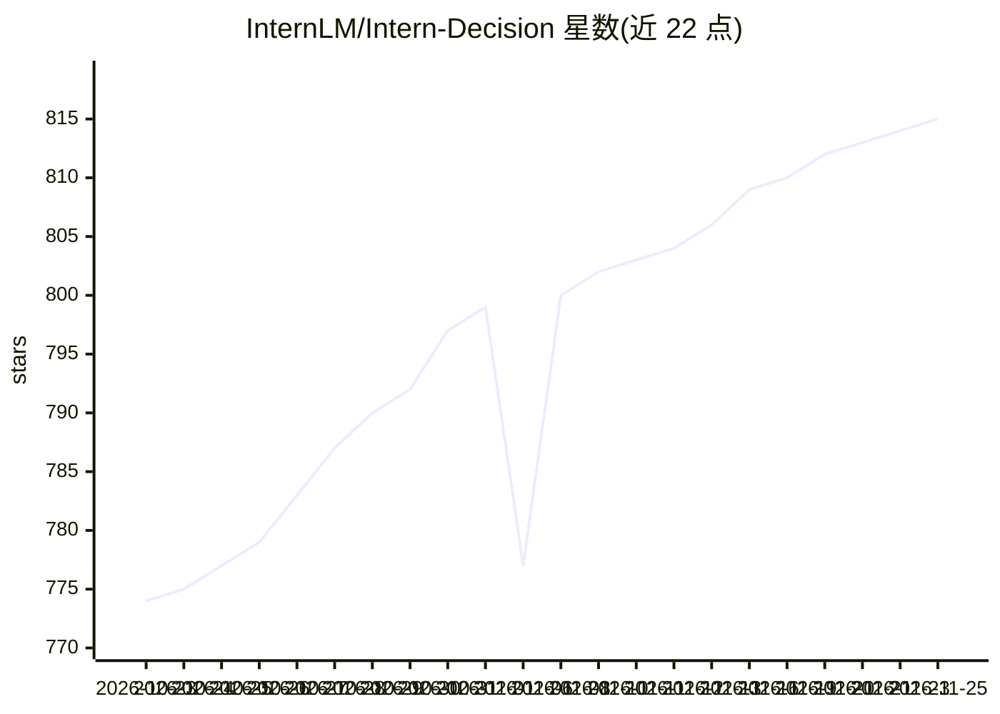

# InternLM/Intern-Decision

⭐ 815 · Python · Apache-2.0 · 推送 2026-11-16 · [GitHub](https://github.com/InternLM/Intern-Decision) · 组织维护 · 中文 README

**多模态决策模型：输入状态与图像，输出带概率的决策**

基于 Qwen3.5 语言骨干微调、冻结视觉塔与投影器的多模态决策模型，将状态、可选图像与多个类型化问题（choice/score/yes-no）在一次前向中映射为带概率的决策。发布内容包括训练流程、HF/XTuner/LMDeploy 推理与部署路径、基准评测、温度校准、浏览器 demo，以及 96 例分布校准基准与七个准确率测试套件；训练数据、私有校准记录与模型权重不在仓库内。运行要求 Linux、Python 3.12 与 CUDA。

## 筛选速览

| 维度 | 判定 | 备注 |
|---|---|---|
| AI 角色 | `ai-native` | 本体是模型或模型工具 |
| 许可风险 | `permissive` | Apache-2.0 |
| 部署形态 | `library` | 以包/库形式分发 |
| 模型依赖 | — | README 未给出锁定关系 |
| 硬件要求 | — | 无带数字的原话,不猜 |
| 安装摩擦 | `medium` | 含编译或系统依赖之一 |
| 成熟度 | — | 结构信号不足 |

## 能力要点

- choice/score/yes-no 三类问题一次前向输出带校准概率的决策
- 提供 HF、XTuner、LMDeploy 三套独立环境的运行与部署路径
- 内置 96 例分布校准基准、确定性生成器与离线打分器
- 发布各 checkpoint 专属温度预设，推理时限制到合法答案符号计算概率

## 适用场景

- 为游戏或浏览器 Agent 提供低延迟的决策打分接口
- 评测并校准 LLM 在类型化决策任务上的概率输出质量
- 基于自己的记录运行推理与离线打分复现评测

## 场景标签

`多模态` `微调` `模型评测` · 领域:评测与运维

## 证据(README 行号)

> L13: Intern-Decision turns a state, optional images, and multiple typed questions into
> L14: decisions with probabilities. It fine-tunes the language backbone of Qwen3.5
> L179: Use Linux, Python 3.12, and CUDA for the trained backends. Run commands from

## 星数曲线

2026-10-23 774 → 2026-11-25 815（+41）

---
*卡片 v1 · prompt 1.4 · 生成 2026-11-24 · 置信度 high · 依据 README sha `d94ab16bbbac` · [字段定义](../../DATASET.md)*
