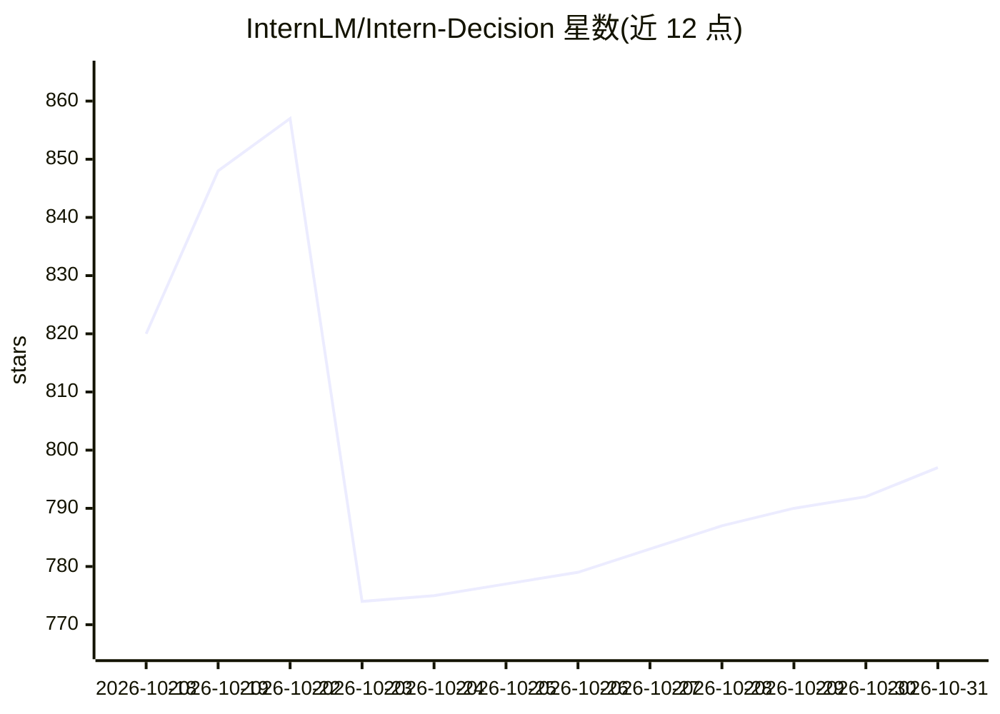

# InternLM/Intern-Decision

⭐ 797 · Python · Apache-2.0 · 推送 2026-10-22 · [GitHub](https://github.com/InternLM/Intern-Decision) · 组织维护 · 中文 README

**多模态决策模型：把状态、图像与问题转为带概率的决策**

Intern-Decision 将状态、可选图像与多类问题（choice/score/noul 是非题）作为输入，输出带概率的决策；通过微调 Qwen3.5 语言骨干（冻结视觉塔与投影层）实现。发布内容包括训练脚本、两个推理后端（Hugging Face 与 XTuner）、基准评分、温度校准与浏览器演示，并附带 96 例分布校准基准与七个精度测试套件。模型权重、训练数据与图像未包含。运行要求 Linux、Python 3.12 与 CUDA，HF 与 XTuner 需分置独立虚拟环境。

## 筛选速览

| 维度 | 判定 | 备注 |
|---|---|---|
| AI 角色 | `ai-native` | 本体是模型或模型工具 |
| 许可风险 | `permissive` | Apache-2.0 |
| 部署形态 | `library` | 以包/库形式分发 |
| 模型依赖 | — | README 未给出锁定关系 |
| 硬件要求 | — | 无带数字的原话,不猜 |
| 安装摩擦 | `medium` | 含编译或系统依赖之一 |
| 成熟度 | — | 结构信号不足 |

## 能力要点

- 支持 choice/score/noul 三种问题类型的概率化决策输出
- 提供 HF 与 XTuner 两个推理后端，RTX 4090 上 4B 模型平均延迟 44.16 ms
- 96 例分布校准基准（确定性生成器 + 离线评分器）与七套件精度评测
- 支持在自备 JSONL 数据上微调 0.8B/2B/4B/9B Qwen3.5 变体

## 适用场景

- 为游戏（Mario/Doom）、浏览器操作等场景输出概率化决策
- 在自备数据上微调决策模型并做温度校准
- 复现精度、延迟与校准基准评测结果

## 场景标签

`多模态` `微调` `模型评测` · 领域:评测与运维

## 证据(README 行号)

> L11: Intern-Decision turns a state, optional images, and multiple typed questions into
> L12: decisions with probabilities. It fine-tunes the language backbone of Qwen3.5
> L16: This release contains training, two inference backends, benchmark scoring,

## 星数曲线

2026-10-18 820 → 2026-10-31 797（-23）

---
*卡片 v1 · prompt 1.4 · 生成 2026-10-21 · 置信度 high · 依据 README sha `43205683f244` · [字段定义](../../DATASET.md)*
