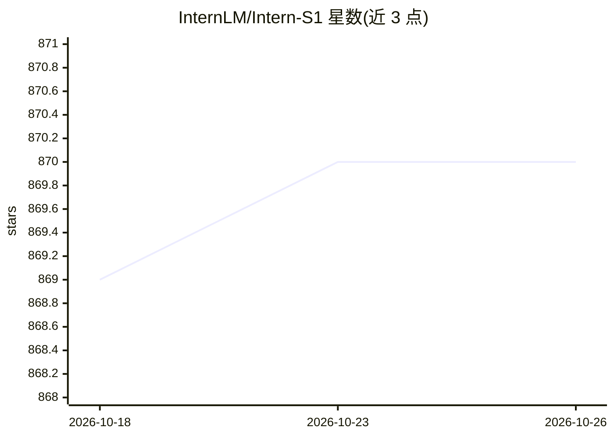

# InternLM/Intern-S1

⭐ 870 · Apache-2.0 · 推送 2026-09-13 · [GitHub](https://github.com/InternLM/Intern-S1) · 组织维护 · 中文 README

**面向科学智能的多模态基础模型系列（Intern-S 系列）**

由 InternLM（上海AI实验室相关团队）发布的科学多模态基础模型系列仓库，包含 Intern-S2-397B、Intern-S2-Preview-397B/35B、Intern-S1-Pro（1T 参数 MoE）、Intern-S1（235B MoE + 6B InternViT）与 Intern-S1-mini（8B+0.3B）。模型经视觉预训练与多任务强化学习，支持科学文献页面直接预训练、跨 20+ 领域科学任务、长程 agent 能力，涵盖化学结构解读、蛋白质序列理解、化合物合成路线规划、材料晶体结构生成等。权重以 BF16/FP8/GGUF 形式发布于 HuggingFace 与 ModelScope，README 报告在通用与科学基准上的评测结果。

## 筛选速览

| 维度 | 判定 | 备注 |
|---|---|---|
| AI 角色 | `ai-native` | 本体是模型或模型工具 |
| 许可风险 | `permissive` | Apache-2.0 |
| 部署形态 | `None` |  |
| 模型依赖 | — | README 未给出锁定关系 |
| 硬件要求 | — | 无带数字的原话,不猜 |
| 安装摩擦 | `low` | 无编译、无系统依赖或容器化 |
| 成熟度 | — | 结构信号不足 |

## 能力要点

- 系列覆盖 397B/35B/1T-MoE/235B-MoE/8B 多种规模，含 FP8 与 GGUF 格式
- 在 5T token 多模态数据上继续预训练，其中 2.5T+ 为科学领域 token
- 动态 tokenizer 支持分子式、蛋白质序列与地震信号的原生理解
- 支持 256K（文本）/64K（多模态）推理长度

## 适用场景

- 科研场景下解读化学结构、理解蛋白质序列
- 规划化合物合成路线等科学任务
- 作为科学领域研究助手部署使用

## 场景标签

`多模态` `科研工具` · 领域:学习与行业

## 证据(README 行号)

> L14: We introduce **Intern-S2-397B**, our most capable multimodal foundation model for scientific intelligence and long-
> L68: Built upon a 235B MoE language model (Qwen3) and a 6B Vision encoder (InternViT), Intern-S1 has been further pretra
> L20: - **Scientific modality reasoning and generation.** By scaling diverse scientific reinforcement-learning tasks acro

## 星数曲线

2026-10-18 869 → 2026-10-26 870（+1）

---
*卡片 v1 · prompt 1.4 · 生成 2026-10-21 · 置信度 high · 依据 README sha `12544f5745e9` · [字段定义](../../DATASET.md)*
