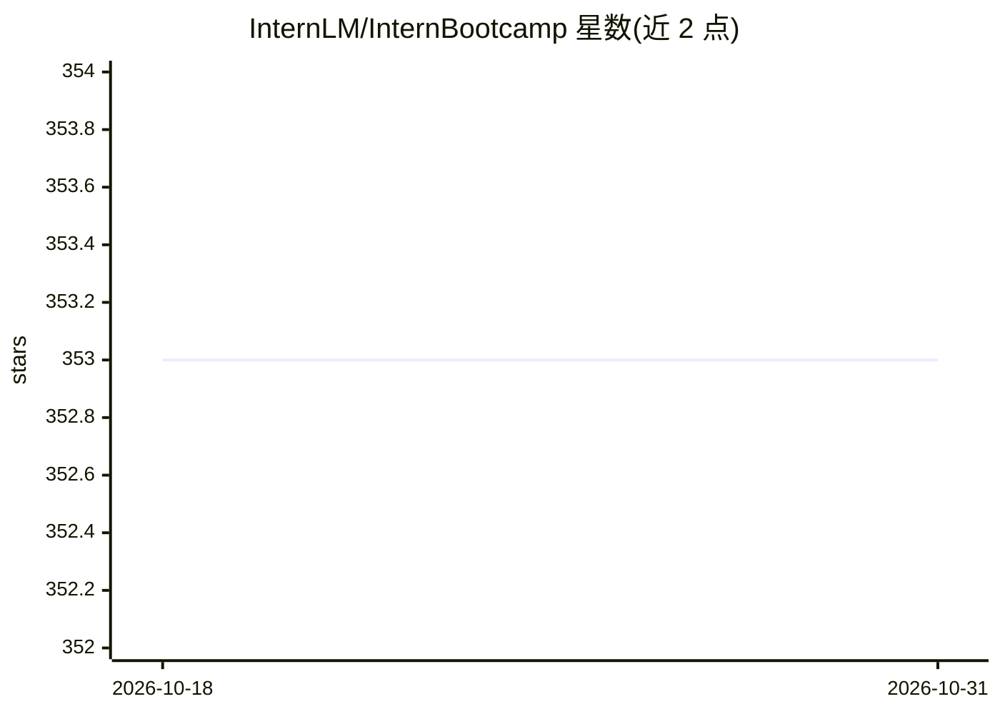

# InternLM/InternBootcamp

⭐ 353 · Python · 推送 2026-09-12 · [GitHub](https://github.com/InternLM/InternBootcamp) · 组织维护 · 中文 README

**面向 LLM 智能体训练与评测的可扩展合成任务环境框架**

InternAgentHarness（InternBootcamp）将智能体任务统一封装为可执行、可交互、可验证的环境实例，每个任务由任务提示生成、工具执行、交互控制、奖励计算四部分组成，覆盖电池设计、路径规划、金融推理、游戏决策等场景。深度绑定 verl 的 multi-round toolcall 流程与 SGLANG rollout 状态控制，支持批量轨迹采集、微调数据过滤、RL rollout 与测试评测，并提供 Master-Worker 分布式工具服务器与 Web 监控面板。面向构建智能体训练环境、评测工具使用能力的研究者与开发者；基于统一基类（InstructionGenerator/Tool/Interaction）扩展自定义任务，经 git clone + pip install -e 安装。技术报告被 WAICA 2026 接收。

## 筛选速览

| 维度 | 判定 | 备注 |
|---|---|---|
| AI 角色 | `ai-ecosystem` | LLM/agent 周边工具 |
| 许可风险 | `none` | — |
| 部署形态 | `library` | 以包/库形式分发 |
| 模型依赖 | — | README 未给出锁定关系 |
| 硬件要求 | — | 无带数字的原话,不猜 |
| 安装摩擦 | `low` | 无编译、无系统依赖或容器化 |
| 成熟度 | — | 结构信号不足 |

## 能力要点

- 任务统一封装为提示生成/工具执行/交互控制/奖励计算四部分的可验证环境
- 绑定 verl multi-round toolcall 与 SGLANG rollout 状态控制的 RL 流程
- Master-Worker 分布式工具服务器：动态注册、负载均衡、健康监控、Web 可视化
- 批量并行数据生成（jsonl/parquet 输出）与完整交互轨迹记录

## 适用场景

- 构建和扩展 LLM 智能体的可验证训练环境
- 批量采集多轮工具调用轨迹用于微调或 RL rollout
- 评测模型的规划、工具使用与长程决策能力

## 场景标签

`模型评测` `强化学习` · 领域:评测与运维

## 证据(README 行号)

> L13: **InternAgentHarness** (InternBootcamp) 是一个面向大语言模型智能体训练与评测的可扩展合成环境框架。
> L17: 在 InternAgentHarness 中，不同类型的智能体任务会被统一封装为可训练的环境实例。每个任务由四个核心部分组成：
> L50: 它将“评测、数据生成、训练、再评测”连接成一个闭环，帮助用户更高效地提升大语言模型在复杂任务中的规划、工具使用、反馈修正和决策能力。

## 星数曲线

2026-10-18 353 → 2026-10-31 353（+0）

---
*卡片 v1 · prompt 1.4 · 生成 2026-10-21 · 置信度 high · 依据 README sha `2166884f2c1d` · [字段定义](../../DATASET.md)*
