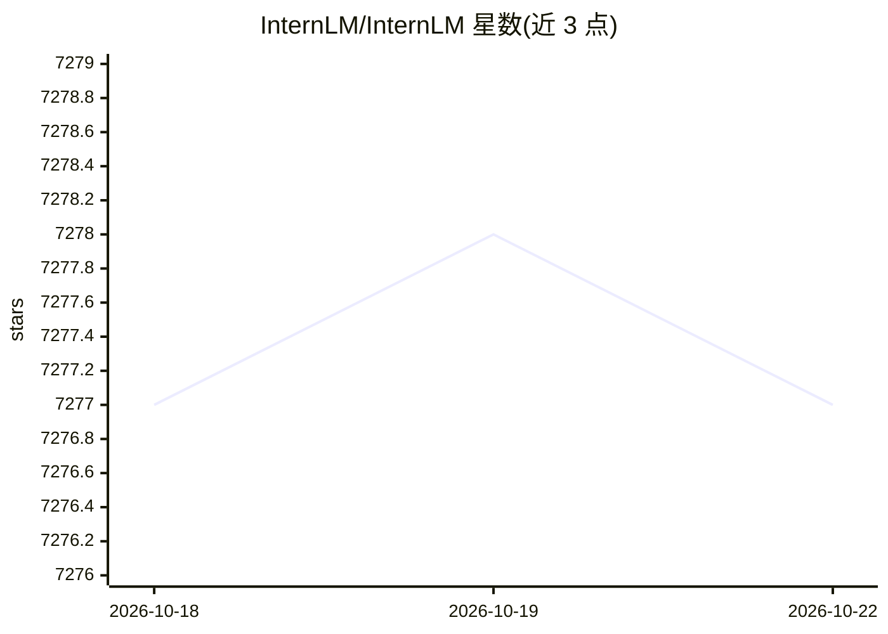

# InternLM/InternLM

⭐ 7,277 · Python · Apache-2.0 · 推送 2025-10-30 · [GitHub](https://github.com/InternLM/InternLM) · [官网](https://internlm.readthedocs.io/) · 组织维护 · 中文 README

**InternLM 系列开源大模型权重发布库（1.8B-20B 多代）**

上海人工智能实验室 InternLM 团队的系列大模型官方发布仓库，覆盖 InternLM、InternLM2、InternLM2.5、InternLM3 各代基座/Chat/Reward 模型，权重托管于 Hugging Face、ModelScope 与 OpenXLab。InternLM3-8B-Instruct 支持深度思考与普通两种回复模式；InternLM2.5 提供 1M 长上下文 Chat 版本，Reward 系列基于 240 万偏好样本训练。README 给出 Transformers、LMDeploy、SGLang 的推理与部署示例（含 OpenAI 兼容服务），并声明模型可能产生有害输出的安全限制。

## 筛选速览

| 维度 | 判定 | 备注 |
|---|---|---|
| AI 角色 | `ai-native` | 本体是模型或模型工具 |
| 许可风险 | `permissive` | Apache-2.0 |
| 部署形态 | `library` | 以包/库形式分发 |
| 模型依赖 | local-ok | 支持本地模型 |
| 硬件要求 | — | 无带数字的原话,不猜 |
| 安装摩擦 | `medium` | 含编译或系统依赖之一 |
| 成熟度 | — | 结构信号不足 |

## 能力要点

- 多代多规格权重：1.8B/7B/8B/20B 基座、Chat、SFT、Reward 及 1M 长上下文版本
- InternLM3-8B-Instruct 支持深度思考（长思维链）与普通对话双模式
- 提供 Transformers / LMDeploy / SGLang 三种推理路径与 OpenAI 兼容服务部署命令
- 权重通过 Hugging Face、ModelScope、OpenXLab 三个渠道分发

## 适用场景

- 下载 InternLM 系列权重用于对话、推理或下游微调
- 用 LMDeploy/SGLang 部署 OpenAI 兼容推理服务
- 用 InternLM2-Reward 做偏好建模或 PPO 训练

## 场景标签

 · 领域:大语言模型/预训练模型

## 证据(README 行号)

> L28: InternLM3 has open-sourced an 8-billion parameter instruction model, InternLM3-8B-Instruct, designed for general-pu
> L61: |Model|Transformers|ModelScope|Modelers|Release Date|
> L162: To load the InternLM3 8B Instruct model using Transformers, use the following code:

## 星数曲线

2026-10-18 7,277 → 2026-10-22 7,277（+0）

---
*卡片 v1 · prompt 1.4 · 生成 2026-10-20 · 置信度 mid · 依据 README sha `d114dcf01fef` · [字段定义](../../DATASET.md)*
