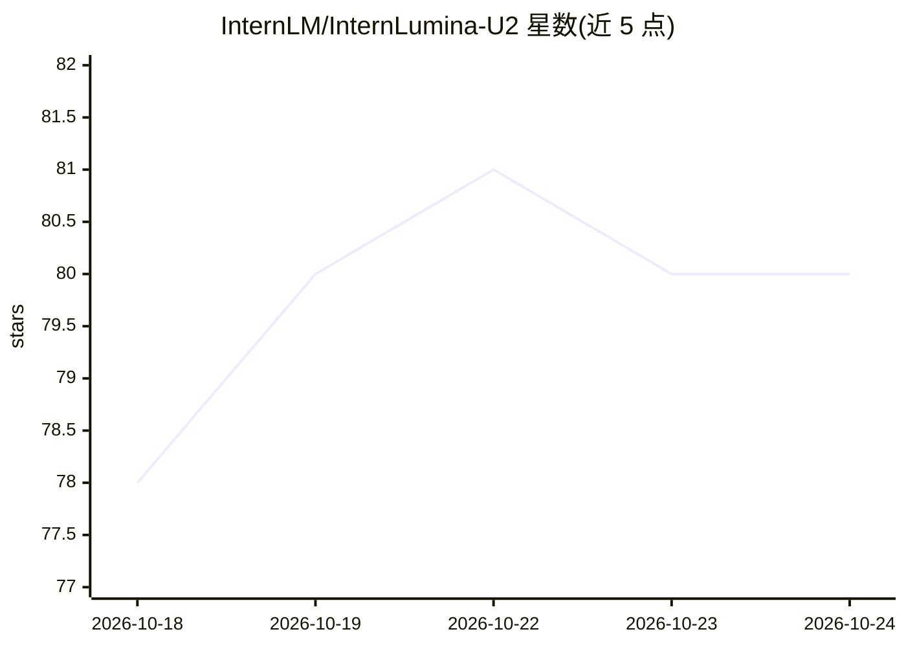

# InternLM/InternLumina-U2

⭐ 80 · Python · Apache-2.0 · 推送 2026-10-20 · [GitHub](https://github.com/InternLM/InternLumina-U2) · [官网](https://internlm.github.io/InternLumina-U2/) · 组织维护 · 中文 README

**统一多模态模型：文生图、图像/视频/3D理解与图像编辑**

上海人工智能实验室发布的 16.9B 参数 MoE 多码本扩散语言模型（每 token 激活约 1.4B），以 LLaDA2.0-mini 为骨干、基于 AToken 的 8 码本全离散视觉表示，用单一模型覆盖文本问答、文生图、图像理解与编辑、视频理解和 3D 理解。提供推理代码、SFT 训练代码与可选的免训练加速路径（PHV，官方标注加速 4.45 倍）。训练与推理支持 NVIDIA 与昇腾（Ascend 在独立分支）。需要 GPU 机器、FlashAttention（视觉 tokenizer 用）与从 Hugging Face 下载的模型权重；3D 理解还需 Blender 渲染。

## 筛选速览

| 维度 | 判定 | 备注 |
|---|---|---|
| AI 角色 | `ai-native` | 本体是模型或模型工具 |
| 许可风险 | `permissive` | Apache-2.0 |
| 部署形态 | `library` | 以包/库形式分发 |
| 模型依赖 | — | README 未给出锁定关系 |
| 硬件要求 | — | 无带数字的原话,不猜 |
| 安装摩擦 | `medium` | 含编译或系统依赖之一 |
| 成熟度 | — | 结构信号不足 |

## 能力要点

- 单一骨干与离散 token 接口覆盖六类视觉/语言任务
- AToken 8 码本视觉表示，空间并行+码book深度自回归预测
- 16.9B MoE 骨干（每 token 激活约 1.4B，256 路由专家）
- 可选 PHV 加速采样（免训练，官方标注 4.45 倍）
- 训练/推理/评测支持 NVIDIA 与 Ascend 双平台

## 适用场景

- 用同一模型做文生图与指令式图像编辑
- 对图像、图表文档、视频与 3D 资产做问答理解
- 基于开源代码与权重做 SFT 训练或加速推理实验

## 场景标签

`多模态` `图像生成` · 领域:内容生成

## 证据(README 行号)

> L18: Intern Lumina U2 is a unified multimodal model that brings language, image, video and 3D into a single framework, c
> L28: **1. One model for omni-visual understanding, image generation and editing.** Text QA, T2I generation, image unders

## 星数曲线

2026-10-18 78 → 2026-10-24 80（+2）

---
*卡片 v1 · prompt 1.4 · 生成 2026-10-24 · 置信度 mid · 依据 README sha `dfb3a0f3844b` · [字段定义](../../DATASET.md)*
