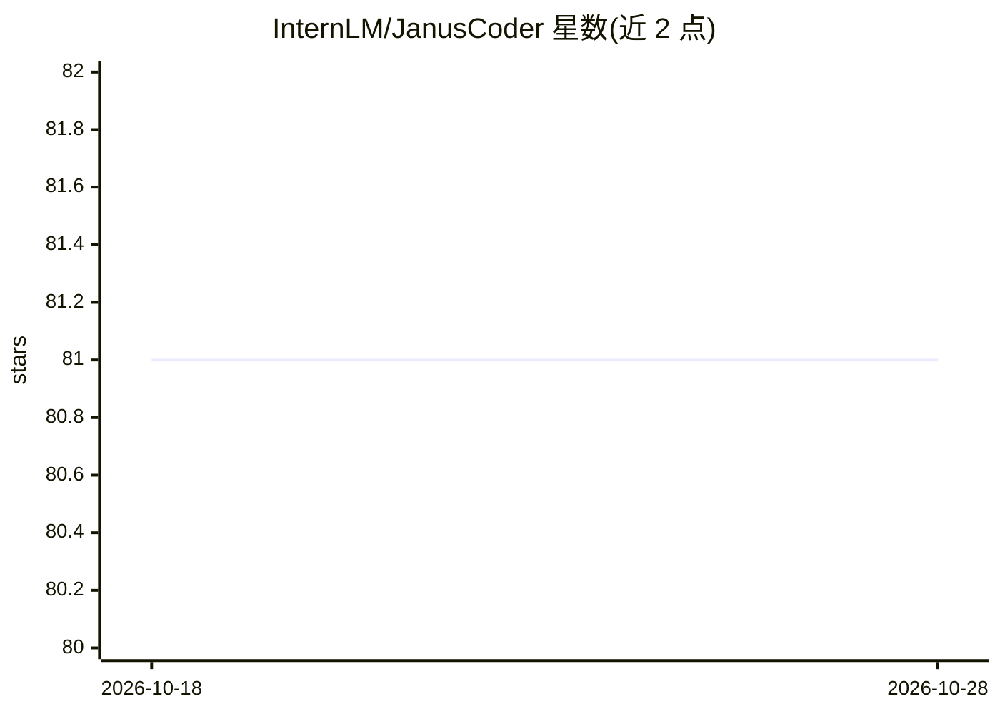

# InternLM/JanusCoder

⭐ 81 · Jupyter Notebook · Apache-2.0 · 推送 2026-05-09 · [GitHub](https://github.com/InternLM/JanusCoder) · 组织维护 · 中文 README

**开源模型套件：统一视觉-程序接口处理多模态代码任务**

ICLR 2026 论文的公开实现，包含 JanusCoder（文本侧，基于 Qwen3-8B/14B）与 JanusCoderV（多模态侧，基于 Qwen2.5-VL/InternVL3.5）系列模型，处理图表转代码、Web UI 生成与编辑、定理可视化等任务。仓库提供 Hugging Face/ModelScope 权重、JanusCode-800K 数据样本、数据合成工具链脚本、训练配置（llamafactory）与各基准评测脚本（vLLM 运行）。声明因公司政策完整实现与数据尚未全部放出，训练在 8×H800 上进行。

## 筛选速览

| 维度 | 判定 | 备注 |
|---|---|---|
| AI 角色 | `ai-native` | 本体是模型或模型工具 |
| 许可风险 | `permissive` | Apache-2.0 |
| 部署形态 | `None` |  |
| 模型依赖 | local-ok | 支持本地模型 |
| 硬件要求 | — | 无带数字的原话,不猜 |
| 安装摩擦 | `low` | 无编译、无系统依赖或容器化 |
| 成熟度 | `idea` | |

## 能力要点

- JanusCoder/JanusCoderV 四个模型权重（8B/14B，文本与多模态）
- 覆盖图表、Web UI、可视化产物等多领域的 JanusCode-800K 数据与合成工具链
- 提供 LlamaFactory 训练配置与 DesignBench/ArtifactBench 等评测脚本

## 适用场景

- 运行或微调模型完成图表转代码、Web UI 生成与编辑任务
- 用数据合成工具链构建多模态代码训练语料
- 在公开基准上复现论文实验结果

## 场景标签

`代码生成` `多模态` `微调` `模型评测` · 领域:编码与开发

## 证据(README 行号)

> L22: JanusCoder is a suite of open models that establish a unified visual–programmatic interface for multimodal code int
> L35: |JanusCoder-8B|8B text model based on Qwen3-8B.|🤗 Model|🤖 Model|

## 星数曲线

2026-10-18 81 → 2026-10-28 81（+0）

---
*卡片 v1 · prompt 1.4 · 生成 2026-10-24 · 置信度 high · 依据 README sha `599e2811282c` · [字段定义](../../DATASET.md)*
