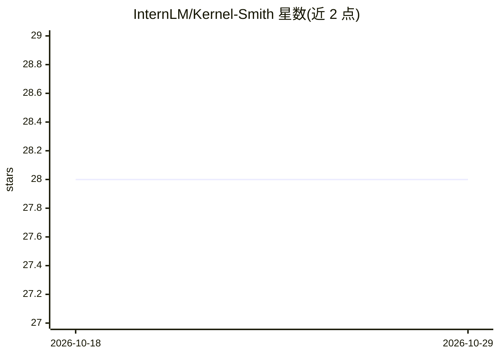

# InternLM/Kernel-Smith

⭐ 28 · Apache-2.0 · 推送 2026-03-31 · [GitHub](https://github.com/InternLM/Kernel-Smith) · 组织维护 · 中文 README

**面向开发者的 GPU kernel 生成系统，产出高性能算子代码**

由上海人工智能实验室与 MetaX 联合开发的 GPU kernel 生成系统：采用基于进化机制的优化循环，在 NVIDIA Triton 与 MetaX MACA 两种后端上做稳定评估，通过奖励保持正确性且提升性能的改动来训练模型改进 kernel。技术报告称在 KernelBench 上超过 Gemini-3.0-pro 与 Claude-4.6-opus。注意：模型权重与 agent 代码目前不计划发布，仓库现阶段聚焦于分享生成的 kernel、基准测试及相关文档，并提供在线 Demo。

## 筛选速览

| 维度 | 判定 | 备注 |
|---|---|---|
| AI 角色 | `ai-native` | 本体是模型或模型工具 |
| 许可风险 | `permissive` | Apache-2.0 |
| 部署形态 | `None` |  |
| 模型依赖 | — | README 未给出锁定关系 |
| 硬件要求 | — | 无带数字的原话,不猜 |
| 安装摩擦 | `low` | 无编译、无系统依赖或容器化 |
| 成熟度 | — | 结构信号不足 |

## 能力要点

- 进化式优化循环，支持 NVIDIA Triton 与 MetaX MACA 双后端评估
- 以'保持正确性且提升性能'为奖励信号训练 kernel 改进
- 生成 kernel 已被 SGLang（4.78x）与 LMDeploy（1.36x）等开源项目集成
- 模型权重与 agent 代码暂不发布，仓库分享 kernel 产物与基准

## 适用场景

- 了解 AI 生成 GPU kernel 的方法与基准结果
- 获取已被推理框架集成的优化算子（SGLang/LMDeploy）
- 通过在线 Demo 体验 kernel 生成

## 场景标签

`代码生成` `模型训练` · 领域:编码与开发

## 证据(README 行号)

> L3: **Kernel-Smith** is a GPU kernel generation system developed by the Shanghai Artificial Intelligence Laboratory and 
> L9: - Uses an evolution-based optimization loop with stable evaluation on both **NVIDIA Triton** and **MetaX MACA** back
> L10: - Trains for kernel improvement by rewarding correctness-preserving changes that increase performance.

## 星数曲线

2026-10-18 28 → 2026-10-29 28（+0）

---
*卡片 v1 · prompt 1.4 · 生成 2026-10-26 · 置信度 high · 依据 README sha `0cc147eaad63` · [字段定义](../../DATASET.md)*
