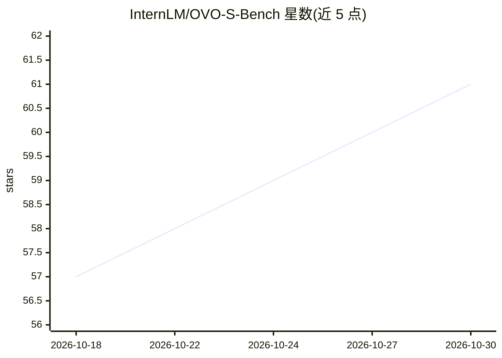

# InternLM/OVO-S-Bench

⭐ 61 · Python · MIT · 推送 2026-10-22 · [GitHub](https://github.com/InternLM/OVO-S-Bench) · 组织维护 · 中文 README

**多模态 LLM 流式空间智能评测基准：1,680 题人工标注数据集**

面向机器人、AR、自动驾驶等流式自我中心视频场景的评测基准：1,680 道题、348 个源视频（来自 9 个公开数据集），由 12 名受训标注者约 804 人时完成多轮质控标注。每题含查询时间戳与证据区间，评测时模型只能看到查询前的前缀。题目按四层递进组织：瞬时自我中心感知、时空上下文跟踪、空间模拟推理、非中心化地图构建。已评测 38 个专有与开源 MLLM，数据集发布于 HuggingFace 与 ModelScope，评测代码开源。

## 筛选速览

| 维度 | 判定 | 备注 |
|---|---|---|
| AI 角色 | `ai-knowledge` | 知识聚合/清单类 |
| 许可风险 | `permissive` | MIT |
| 部署形态 | `desktop` | 安装包/桌面程序 |
| 模型依赖 | — | README 未给出锁定关系 |
| 硬件要求 | — | 无带数字的原话,不猜 |
| 安装摩擦 | `low` | 无编译、无系统依赖或容器化 |
| 成熟度 | — | 结构信号不足 |

## 能力要点

- 1,680 题 / 348 视频 / 30 种任务类型，四级空间能力分类
- 流式评测协议：模型仅见查询时间戳前的视频前缀
- 804 人时人工标注加双盲交叉审查与捷径消除质控
- 38 个 MLLM 排行榜与交互式在线版本

## 适用场景

- 评估多模态 LLM 在流式视频下的空间理解能力
- 对比开源与闭源模型的时空记忆与地图推理表现
- 为具身智能与 AR 应用选型提供空间智能评测依据

## 场景标签

`模型评测` `多模态` · 领域:评测与运维

## 证据(README 行号)

> L3:  A Hierarchical Benchmark for Streaming Spatial Intelligence in Multimodal LLMs
> L31: Multimodal agents in robotics, AR, and autonomous driving must reason about places and layouts from continuous egoc

## 星数曲线

2026-10-18 57 → 2026-10-30 61（+4）

---
*卡片 v1 · prompt 1.4 · 生成 2026-10-24 · 置信度 mid · 依据 README sha `f0504886c538` · [字段定义](../../DATASET.md)*
