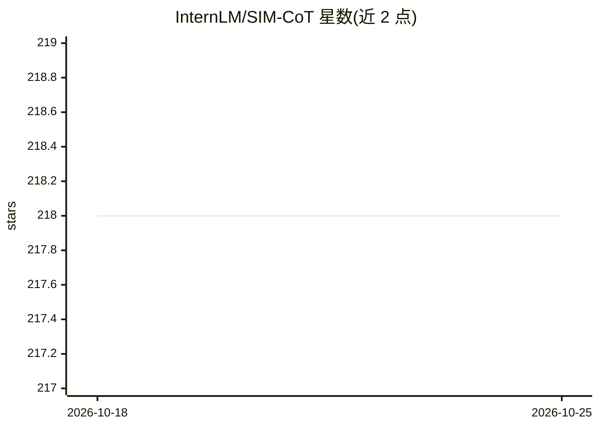

# InternLM/SIM-CoT

⭐ 218 · Python · Apache-2.0 · 推送 2026-04-13 · [GitHub](https://github.com/InternLM/SIM-CoT) · [官网](https://arxiv.org/pdf/2509.20317) · 组织维护 · 中文 README

**隐式思维链训练框架：用步级监督稳定潜在推理**

面向 LLM 隐式推理的训练框架：训练时附加轻量辅助解码器，将每个隐式潜在 token 对齐到对应推理步骤，施加步级监督，缓解隐式 token 数量扩大时的潜在不稳定（语义同质化、算子信息丢失、训练崩溃）；推理时移除辅助解码器，不增加推理开销，且每个潜在 token 可解码为可读推理步骤。基于 Coconut 与 CODI 代码库构建，提供 GPT-2 与 LLaMA（1B/3B/8B）的训练与评测流程，ICLR 2026 论文官方实现。

## 筛选速览

| 维度 | 判定 | 备注 |
|---|---|---|
| AI 角色 | `ai-ecosystem` | LLM/agent 周边工具 |
| 许可风险 | `permissive` | Apache-2.0 |
| 部署形态 | `library` | 以包/库形式分发 |
| 模型依赖 | — | README 未给出锁定关系 |
| 硬件要求 | — | 无带数字的原话,不猜 |
| 安装摩擦 | `low` | 无编译、无系统依赖或容器化 |
| 成熟度 | — | 结构信号不足 |

## 能力要点

- 辅助解码器实现隐式潜在 token 的步级监督
- 推理时移除辅助解码器，不增加推理开销
- 基于 Coconut 与 CODI 代码库构建，提供两套训练/评测流程
- 支持 GPT-2 与 LLaMA（1B/3B/8B）

## 适用场景

- 训练具有隐式推理能力的 LLM 并降低推理 token 开销
- 研究隐式思维链中潜在空间语义结构
- 复现或对比 Coconut/CODI 等隐式 CoT 方法

## 场景标签

`微调` · 领域:训练与推理

## 证据(README 行号)

> L10: 🌈 **SIM-CoT (Supervised Implicit Chain-of-Thought)** is a training framework for implicit reasoning that makes late
> L14: SIM-CoT addresses this by introducing **step-level supervision for implicit latents**. During training, we attach a

## 星数曲线

2026-10-18 218 → 2026-10-25 218（+0）

---
*卡片 v1 · prompt 1.4 · 生成 2026-10-22 · 置信度 mid · 依据 README sha `2170efc6461a` · [字段定义](../../DATASET.md)*
