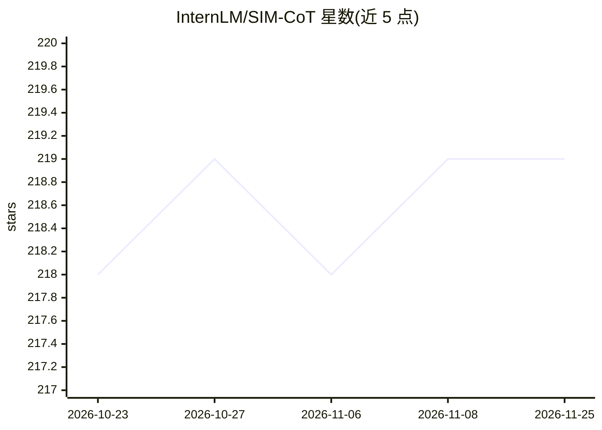

# InternLM/SIM-CoT

⭐ 219 · Python · Apache-2.0 · 推送 2026-10-28 · [GitHub](https://github.com/InternLM/SIM-CoT) · [官网](https://arxiv.org/pdf/2509.20317) · 组织维护 · 中文 README

**ICLR 2026 隐式思维链训练方法的官方实现**

论文 SIM-CoT 的官方代码仓库：在 Coconut、CODI 等隐式推理方法上增加步级监督——训练时用辅助解码器从每个隐变量恢复对应推理步，推理时移除解码器以保持推理紧凑，也可重新接入解码器检查隐变量。仓库包含 Coconut 与 CODI 两套训练/评估代码、预处理脚本与 YAML 配置，实验覆盖 GPT-2 与 LLaMA 系列在 GSM8k-Aug 及 OOD 数据集上的复现。

## 筛选速览

| 维度 | 判定 | 备注 |
|---|---|---|
| AI 角色 | `ai-native` | 本体是模型或模型工具 |
| 许可风险 | `permissive` | Apache-2.0 |
| 部署形态 | `library` | 以包/库形式分发 |
| 模型依赖 | — | README 未给出锁定关系 |
| 硬件要求 | — | 无带数字的原话,不猜 |
| 安装摩擦 | `medium` | 含编译或系统依赖之一 |
| 成熟度 | — | 结构信号不足 |

## 能力要点

- 训练时辅助解码器提供逐步推理监督，推理时移除
- 提供 Coconut 与 CODI 两套实现及独立依赖集
- 附 GSM8k-Aug 预处理脚本与训练/评估 YAML 配置
- 论文中 GSM8k-Aug 上 Coconut+SIM-CoT 提升 8.2-9.0 pp

## 适用场景

- 复现论文中隐式推理基线与 SIM-CoT 对比实验
- 在 GSM8k 类数学推理任务上训练隐式思维链模型
- 研究隐变量推理中的训练不稳定问题

## 场景标签

`微调` · 领域:训练与推理

## 证据(README 行号)

> L17: SIM-CoT adds **step-level supervision** to implicit reasoning methods such as
> L95: paths before launching; the repository contains training code and configurations,

## 星数曲线

2026-10-23 218 → 2026-11-25 219（+1）

---
*卡片 v1 · prompt 1.4 · 生成 2026-11-25 · 置信度 high · 依据 README sha `436cb4ebbfe0` · [字段定义](../../DATASET.md)*
