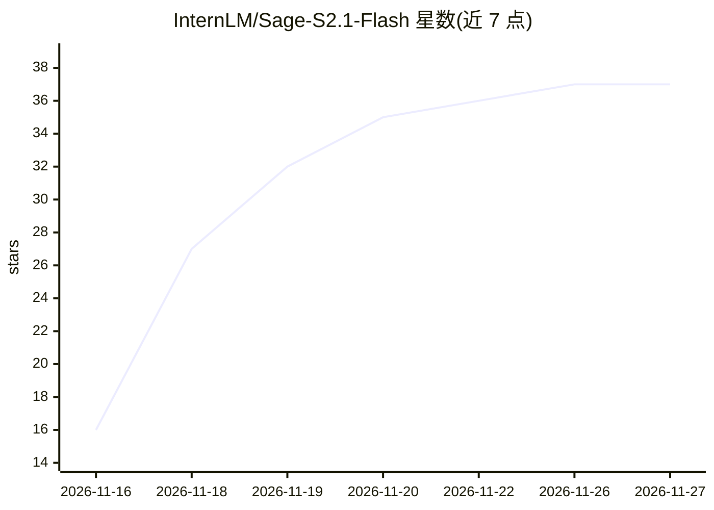

# InternLM/Sage-S2.1-Flash

⭐ 37 · 推送 2026-11-17 · [GitHub](https://github.com/InternLM/Sage-S2.1-Flash) · [官网](https://internlm.github.io/Sage-S2.1-Flash/) · 组织维护 · 中文 README

**科研多模态大模型：理解十余类科学数据并执行分析任务**

上海人工智能实验室发布的科学多模态模型，面向需要多轮分析与验证的科研任务。通过 Sage SciPerception 统一表征架构，将分子图、晶体结构、蛋白质序列与 3D 结构等十余类科学输入编码投影到共享表征空间，与自然语言指令一同参与推理，支持预测、分类、位点定位与结构推断等任务。模型权重提供常规版与 FP8 版，经 Hugging Face/ModelScope 下载，推理通过 vLLM 服务器配合科学投影器完成。代码与权重以 MIT 许可发布。

## 筛选速览

| 维度 | 判定 | 备注 |
|---|---|---|
| AI 角色 | `ai-native` | 本体是模型或模型工具 |
| 许可风险 | `none` | — |
| 部署形态 | `library` | 以包/库形式分发 |
| 模型依赖 | local-ok | 支持本地模型 |
| 硬件要求 | — | 无带数字的原话,不猜 |
| 安装摩擦 | `low` | 无编译、无系统依赖或容器化 |
| 成熟度 | — | 结构信号不足 |

## 能力要点

- Sage SciPerception 统一表征支持十余类科学输入
- 结合检索、编程与工具使用执行多轮分析验证
- 提供常规版与 FP8 版模型权重下载
- 在 15 个基准上给出与五个基线模型的评测结果

## 适用场景

- 材料/蛋白质等科学数据的性质预测与结构推断
- 需要调用专业软件并检查中间输出的科研分析任务
- 编码、办公文档处理与计算机使用等通用任务部署

## 场景标签

`多模态` `科研工具` · 领域:学习与行业

## 证据(README 行号)

> L7: **Sage S2.1 Flash** is a scientific multimodal model from Shanghai Artificial Intelligence Laboratory designed for r
> L11: Through the unified representation architecture of **Sage SciPerception**, the model supports more than ten types o

## 星数曲线

2026-11-16 16 → 2026-11-27 37（+21）

---
*卡片 v1 · prompt 1.4 · 生成 2026-11-18 · 置信度 mid · 依据 README sha `86b1f4b9fcf7` · [字段定义](../../DATASET.md)*
