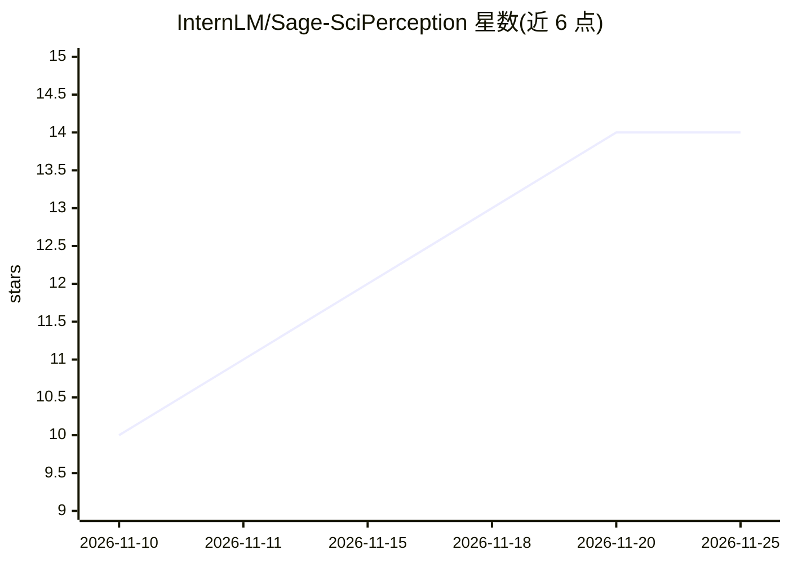

# InternLM/Sage-SciPerception

⭐ 14 · JavaScript · 推送 2026-11-06 · [GitHub](https://github.com/InternLM/Sage-SciPerception) · [官网](https://huggingface.co/internlm/Sage-SciPerception) · 组织维护 · 中文 README

**通过任务专用投影器把科学数据接入语言模型做分析预测**

Sage Sci Perception 将科学编码器状态、光谱片段与科学读出量映射到语言模型输入嵌入空间：每类任务（晶体、光谱、蛋白质/DNA/RNA 序列、ECG/EEG 信号）训练一个专用投影器，训练时科学模型与语言模型冻结。推理时客户端在本地准备科学特征并组装 prompt 嵌入，经 vLLM 的 prompt_embeds 接口生成自然语言分析或结构化答案。权重与配置从 Hugging Face 下载，投影器加载可在 CPU 上验证，语言模型服务需 GPU 环境。

## 筛选速览

| 维度 | 判定 | 备注 |
|---|---|---|
| AI 角色 | `ai-native` | 本体是模型或模型工具 |
| 许可风险 | `none` | — |
| 部署形态 | `library` | 以包/库形式分发 |
| 模型依赖 | local-ok | 支持本地模型 |
| 硬件要求 | — | 无带数字的原话,不猜 |
| 安装摩擦 | `low` | 无编译、无系统依赖或容器化 |
| 成熟度 | — | 结构信号不足 |

## 能力要点

- 任务专用投影器将晶体/光谱/生物序列/生理信号映射进语言模型嵌入空间
- 客户端经 vLLM prompt_embeds 接口注入科学向量生成回答
- 投影器加载可在 CPU 上验证，无需下载语言模型或 GPU
- 覆盖 9 项基准任务的评测分数与对应 checkpoint

## 适用场景

- 用 IR/Raman/UV-Vis 三种光谱识别分子结构
- 预测晶体材料的形成能等性质
- 分析蛋白质界面位点与 RNA/剪切位点分类
- ECG 分类与睡眠分期等生理信号任务

## 场景标签

`多模态` `科研工具` · 领域:学习与行业

## 证据(README 行号)

> L15: Sage Sci Perception maps scientific encoder states, spectral patches, and scientific readouts into a language model
> L71: The serving path inserts projected scientific vectors into a language model's full templated prompt embeddings and 
> L121: A task-specific projector maps scientific representations into the language model's embedding space. During langua

## 星数曲线

2026-11-10 10 → 2026-11-25 14（+4）

---
*卡片 v1 · prompt 1.4 · 生成 2026-11-18 · 置信度 high · 依据 README sha `4a1a0e1e6490` · [字段定义](../../DATASET.md)*
