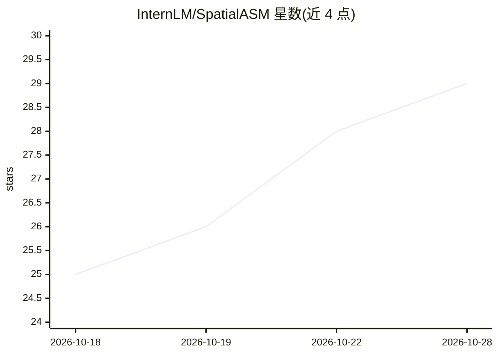

# InternLM/SpatialASM

⭐ 29 · Python · 推送 2026-10-17 · [GitHub](https://github.com/InternLM/SpatialASM) · 组织维护 · 中文 README

**面向 LVLM 的空间推理训练框架与配套模型/数据集**

论文官方实现：将主动空间心理化（ASM）内化到 LVLM 的两阶段训练框架，包含非自我中心新视角生成器（SpatialASM-NVG）、规划-想象-推理轨迹合成（SFT）与视角想象强化学习（GRPO）。发布四个基于 Qwen3-VL/Qwen3.5 的微调 LVLM、SpatialASM-128k/66k/RL-58k 等数据集及 NVG 模型。推理可通过 vLLM 服务器或 Transformers 加载，训练基于 DiffSynth-Studio，评测基于 VLMEvalKit；LVLM 训练代码尚未发布，代码与数据仅限研究用途。

## 筛选速览

| 维度 | 判定 | 备注 |
|---|---|---|
| AI 角色 | `ai-native` | 本体是模型或模型工具 |
| 许可风险 | `none` | — |
| 部署形态 | `None` |  |
| 模型依赖 | local-ok | 支持本地模型 |
| 硬件要求 | — | 无带数字的原话,不猜 |
| 安装摩擦 | `low` | 无编译、无系统依赖或容器化 |
| 成熟度 | `idea` | |

## 能力要点

- 两阶段训练：plan-imagine-reason 轨迹 SFT + 视角想象 GRPO 强化学习
- 发布 4B/8B/9B 三个 LVLM 与新视角生成器 SpatialASM-NVG
- GeoP 几何扰动与答案一致性过滤合成视角
- 推理时不依赖世界模型、渲染器或额外视觉观测

## 适用场景

- 下载微调 LVLM 做空间推理/VQA 任务推理
- 使用 SpatialASM 数据集微调自己的空间推理模型
- 基于框架复现论文训练与评测流程

## 场景标签

`微调` `强化学习` `图像生成` · 领域:内容生成

## 证据(README 行号)

> L32: - 🚀 [2025/10/14] We have released three LVLMs equipped with internalized ASM capabilities for complex spatial reaso
> L39: We are thrilled to introduce **SpatialASM**, a scalable framework that internalizes ASM into LVLMs. Through the two
> L67: Here we provide some simple inference code for you to try our models. The models include the LVLMs such as 🤗Spatial

## 星数曲线

2026-10-18 25 → 2026-10-28 29（+4）

---
*卡片 v1 · prompt 1.4 · 生成 2026-10-26 · 置信度 high · 依据 README sha `1ee90e2462e4` · [字段定义](../../DATASET.md)*
