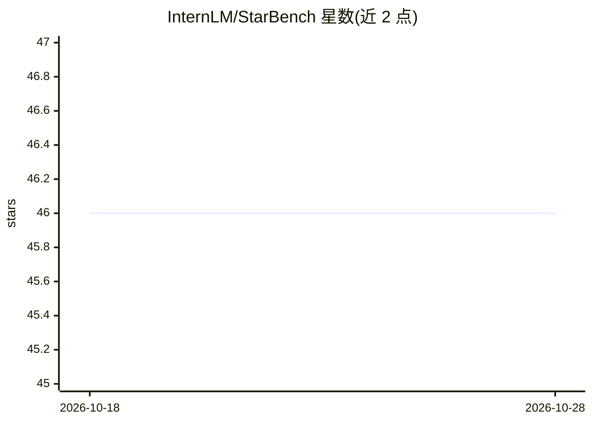

# InternLM/StarBench

⭐ 46 · Python · MIT · 推送 2026-04-19 · [GitHub](https://github.com/InternLM/StarBench) · [官网](https://internlm.github.io/StarBench/) · 组织维护 · 中文 README

**音频 4D 时空推理基准数据集与评测管线（ICLR 2026）**

STAR-Bench 是一个评测音频模型时空推理能力（audio 4D intelligence）的基准：包含基础声学感知（绝对/相对两种范式下六种属性）与整体时空推理（片段重排序、静态定位、多源关系、动态轨迹）两类设定。数据由参数化合成与 Pyroomacoustics 物理仿真生成并经专家校准。代码改编自 VLMEvalKit 与 Kimi-Audio-Evalkit，提供统一评测管线，已适配 Qwen2.5-Omni、Kimi-Audio、Gemini、GPT-4o Audio 等 19 个模型，通过实现 generate_inner() 可接入新模型；数据与代码仅限研究用途。

## 筛选速览

| 维度 | 判定 | 备注 |
|---|---|---|
| AI 角色 | `ai-knowledge` | 知识聚合/清单类 |
| 许可风险 | `permissive` | MIT |
| 部署形态 | `None` |  |
| 模型依赖 | — | README 未给出锁定关系 |
| 硬件要求 | — | 无带数字的原话,不猜 |
| 安装摩擦 | `low` | 无编译、无系统依赖或容器化 |
| 成熟度 | — | 结构信号不足 |

## 能力要点

- 基础声学感知（6 属性×绝对/相对）与时空推理（重排序/定位/轨迹）两类评测设定
- 数据经参数化合成与 Pyroomacoustics 物理仿真，并由领域专家校准
- 统一评测管线，支持 Qwen2.5-Omni/Kimi-Audio/Gemini/GPT-4o Audio 等 9+ 模型，可实现 generate_inner() 接入新模型
- v1.0 数据集发布于 HuggingFace，结果保存至本地 eval_results 目录

## 适用场景

- 评测我的音频多模态模型在时空推理上的表现
- 对比开源/闭源模型的细粒度声学感知能力
- 为音频 4D 理解研究提供数据集与评测协议

## 场景标签

`模型评测` · 领域:评测与运维

## 证据(README 行号)

> L47: We formalize audio 4D intelligence that is defined as reasoning over sound dynamics in time and 3D space, and intro
> L84: It provides a unified evaluation pipeline for multimodal large models on **STAR-Bench**.

## 星数曲线

2026-10-18 46 → 2026-10-28 46（+0）

---
*卡片 v1 · prompt 1.4 · 生成 2026-10-25 · 置信度 mid · 依据 README sha `e4c87f5b6acb` · [字段定义](../../DATASET.md)*
