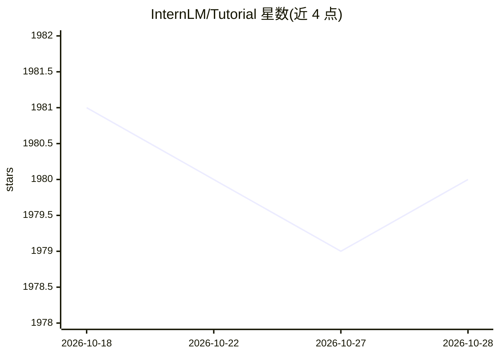

# InternLM/Tutorial

⭐ 1,980 · Python · 推送 2026-04-22 · [GitHub](https://github.com/InternLM/Tutorial) · 组织维护 · 中文 README

**书生大模型实战营第三期课程：分关卡的大模型学习教程**

上海AI实验室书生（InternLM）体系的大模型教学仓库，以闯关形式组织课程：入门岛（Linux/Python/Git 基础）、基础岛（Demo 体验、提示词工程、LlamaIndex RAG、XTuner 微调、OpenCompass 评测）、进阶岛（Lagent 智能体、LMDeploy 部署、InternVL 多模态、茴香豆知识库问答、MindSearch）、彩蛋岛（Android 端侧部署等）。每关提供任务、文档、视频资料及算力点激励，完成进阶可获结营证书；另含邀请制的书生共学计划。面向大模型学习者。

## 筛选速览

| 维度 | 判定 | 备注 |
|---|---|---|
| AI 角色 | `ai-knowledge` | 知识聚合/清单类 |
| 许可风险 | `none` | — |
| 部署形态 | `None` |  |
| 模型依赖 | — | README 未给出锁定关系 |
| 硬件要求 | — | 无带数字的原话,不猜 |
| 安装摩擦 | `low` | 无编译、无系统依赖或容器化 |
| 成熟度 | — | 结构信号不足 |

## 能力要点

- 四个难度层级约 20 关的课程组织，含任务/文档/视频资料
- 覆盖微调、部署、评测、Agent、RAG、多模态全链路实践
- 配套算力点激励、结营证书与 InternStudio 算力奖励（A100）

## 适用场景

- 系统学习 InternLM 系列工具链与大模型开发实践
- 参加闯关挑战获取算力点与结营证书
- 入门 Linux/Python/Git 后进入大模型微调与部署实践

## 场景标签

`教程课程` · 领域:学习与行业

## 证据(README 行号)

> L1: # 书生大模型实战营（第三期闯关大挑战）
> L23: |第 1 关|书生大模型全链路开源体系|任务、视频|100元算力点|
> L35: |第 2 关|Lagent 自定义你的 Agent 智能体|任务、文档、视频|100元算力点|

## 星数曲线

2026-10-18 1,981 → 2026-10-28 1,980（-1）

---
*卡片 v1 · prompt 1.4 · 生成 2026-10-21 · 置信度 high · 依据 README sha `f009a7bf1737` · [字段定义](../../DATASET.md)*
