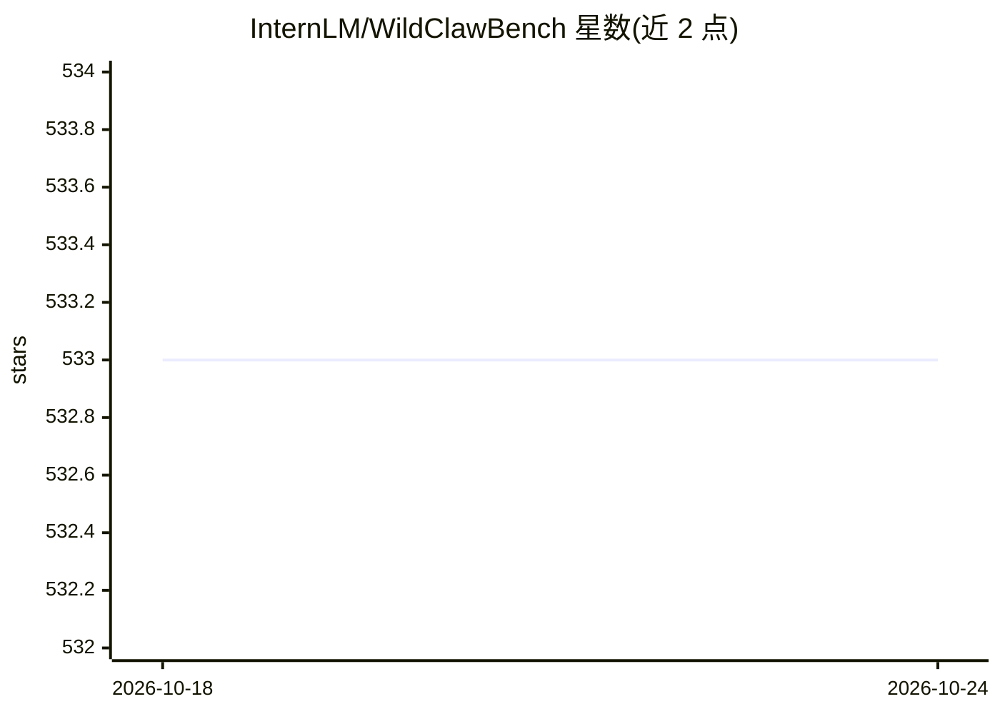

# InternLM/WildClawBench

⭐ 531 · Python · MIT · 推送 2026-09-18 · [GitHub](https://github.com/InternLM/WildClawBench) · [官网](https://internlm.github.io/WildClawBench/) · 组织维护 · 中文 README

**AI agent 端到端实战基准：60 个真实任务 + 四种 harness 对比评测**

InternLM 维护的 agent 评测基准：将 agent 放入真实运行的 OpenClaw 环境执行 60 个手工设计的任务，覆盖多步工具编排、多模态、长程规划、代码与安全 6 大类，中英双语。同一任务套件可在 OpenClaw、Claude Code、Codex CLI、Hermes Agent 四种 harness 下运行，用以区分模型能力与脚手架影响；每任务在独立 Docker 容器中运行，评分脚本在执行后注入以防数据泄露。评测代码在本仓库，数据以三个 Hugging Face 数据集发布，另有 Harbor 格式版本与轨迹数据集。

## 筛选速览

| 维度 | 判定 | 备注 |
|---|---|---|
| AI 角色 | `ai-ecosystem` | LLM/agent 周边工具 |
| 许可风险 | `permissive` | MIT |
| 部署形态 | `library` | 以包/库形式分发 |
| 模型依赖 | — | README 未给出锁定关系 |
| 硬件要求 | — | 无带数字的原话,不猜 |
| 安装摩擦 | `medium` | 含编译或系统依赖之一 |
| 成熟度 | — | 结构信号不足 |

## 能力要点

- 60 个手工设计的端到端任务，6 大类别，中英双语
- 同一任务套件在四种 agent harness（OpenClaw/Claude Code/Codex CLI/Hermes Agent）下对比评测
- 每任务独立 Docker 容器运行，评分脚本执行后注入，跨机器可复现
- 发布模型榜与 harness 对比双榜单，含时间与成本统计

## 适用场景

- 评测自研 agent 或模型在真实工具环境中的端到端能力
- 对比不同 agent harness 脚手架对同一模型表现的影响
- 获取前沿模型的长程 agent 轨迹数据用于分析或训练

## 场景标签

`模型评测` · 领域:评测与运维

## 证据(README 行号)

> L20: **WildClawBench** is an agent benchmark that tests what actually matters: can an AI agent do real work, end-to-end,
> L42: - **Four agent harnesses, one task suite.** OpenClaw, Claude Code, Codex CLI, and Hermes Agent all execute the same
> L47: The evaluation code lives in this repository; the benchmark data ships as three Hugging Face datasets — pick the on

## 星数曲线

2026-10-18 533 → 2026-10-24 533（+0）

---
*卡片 v1 · prompt 1.4 · 生成 2026-10-21 · 置信度 mid · 依据 README sha `f6497f7e773a` · [字段定义](../../DATASET.md)*
