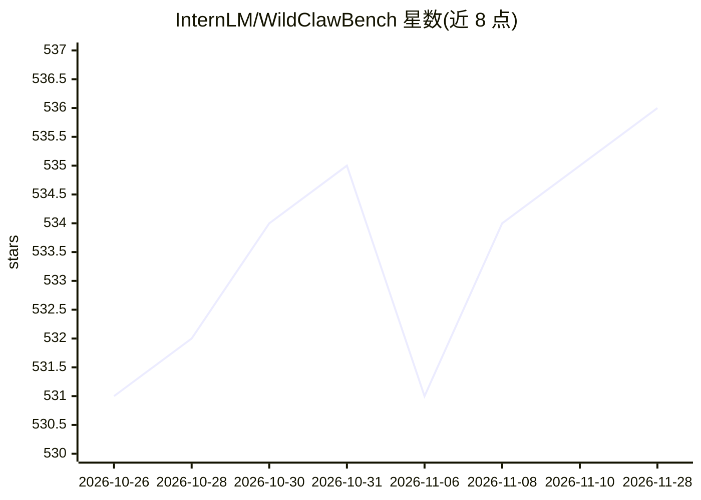

# InternLM/WildClawBench

⭐ 536 · Python · MIT · 推送 2026-11-18 · [GitHub](https://github.com/InternLM/WildClawBench) · [官网](https://internlm.github.io/WildClawBench/) · 组织维护

**评测 AI agent 真实环境端到端任务完成能力的基准**

面向生产级 agent harness 的野外评测基准：在真实 OpenClaw 助手环境中执行 60 个原创任务，覆盖多模态、长时程、编码、检索与安全对齐 6 类，任务以中英文双语提供。每任务在独立 Docker 容器中隔离运行，评分脚本在 agent 结束后注入以防数据泄漏；提供统一 harness 下 34 个模型的榜单与同一模型跨 4 种 harness 的对照评测，配套 Roller 工具收集与评分轨迹。评测代码在本仓库，基准数据以三个 Hugging Face 数据集分发。

## 筛选速览

| 维度 | 判定 | 备注 |
|---|---|---|
| AI 角色 | `ai-ecosystem` | LLM/agent 周边工具 |
| 许可风险 | `permissive` | MIT |
| 部署形态 | `self-host` | docker 或自建部署 |
| 模型依赖 | — | README 未给出锁定关系 |
| 硬件要求 | — | 无带数字的原话,不猜 |
| 安装摩擦 | `low` | 无编译、无系统依赖或容器化 |
| 成熟度 | — | 结构信号不足 |

## 能力要点

- 60 个原创任务、6 大类别，运行于真实 OpenClaw 环境而非 mock
- 四种 agent harness（OpenClaw/Claude Code/Codex CLI/Hermes Agent）执行同一任务集
- 每任务独立 Docker 容器隔离，评分脚本事后注入，分数跨机器可复现
- 三个 Hugging Face 数据集：任务数据、Harbor 格式包、720 条已评分轨迹

## 适用场景

- 评估我的 agent 模型在端到端真实任务上的表现
- 对比同一模型在不同 agent scaffold 下的得分差异
- 挖掘已发布的长时程 agent 轨迹用于分析与训练

## 场景标签

`模型评测` · 领域:评测与运维

## 证据(README 行号)

> L21: **WildClawBench** is an agent benchmark that tests what actually matters: can an AI agent do real work, end-to-end,
> L43: - **Four agent harnesses, one task suite.** OpenClaw, Claude Code, Codex CLI, and Hermes Agent all execute the same
> L44: - **Reproducible & isolated.** Each task runs in its own Docker container. Same image, same data, same grading code

## 星数曲线

2026-10-26 531 → 2026-11-28 536（+5）

---
*卡片 v1 · prompt 1.4 · 生成 2026-11-25 · 置信度 mid · 依据 README sha `056add6f9570` · [字段定义](../../DATASET.md)*
