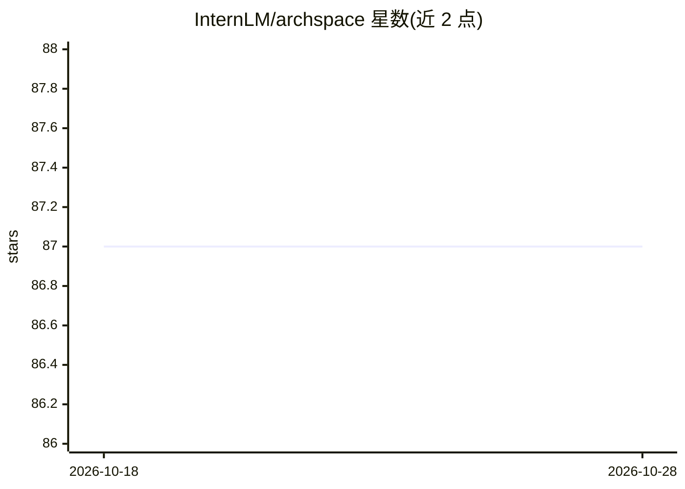

# InternLM/archspace

⭐ 88 · Apache-2.0 · 推送 2026-08-27 · [GitHub](https://github.com/InternLM/archspace) · [官网](https://www.archspace.live/) · 组织维护 · 中文 README

**面向社区的 LLM 架构假设开放式验证与知识共享实验**

由 InternLM 实验室发起的开放实验项目：社区提交 LLM 架构创新提案，经评审委员会按新颖性、可行性与实验严谨性评审后，进入对齐 Olmo 3 流程的完整验证管线（1B/3B/8B 模型、预训练/中期训练/指令微调、约 6.2T tokens），训练与评测日志通过 W&B 公开。正面、负面与条件性结果连同实现、配置与结论均作为共享知识发布。贡献方式包括提案 Issue、实现与评测 PR、复现验证；被采纳的创新可获实验室开源贡献认可及联合任命或实习机会。

## 筛选速览

| 维度 | 判定 | 备注 |
|---|---|---|
| AI 角色 | `ai-knowledge` | 知识聚合/清单类 |
| 许可风险 | `permissive` | Apache-2.0 |
| 部署形态 | `None` |  |
| 模型依赖 | — | README 未给出锁定关系 |
| 硬件要求 | — | 无带数字的原话,不猜 |
| 安装摩擦 | `low` | 无编译、无系统依赖或容器化 |
| 成熟度 | — | 结构信号不足 |

## 能力要点

- 社区提案经同行评审后进入完整训练验证管线（1B/3B/8B，约 6.2T tokens）
- 训练与评测日志通过 W&B 持续公开
- 正面、负面与条件性结果均发布为共享知识
- 验证流程对齐完全开放的 Olmo 3 模型流程

## 适用场景

- 提交自己的 LLM 架构创新想法并获得公开验证
- 查阅已验证架构的实验记录、指标与设计权衡
- 通过实现、评测或复现参与开源协作并获实验室认可

## 场景标签

`模型训练` `模型评测` `科研工具` · 领域:评测与运维

## 证据(README 行号)

> L18: ArchSpace is an open experiment for large language model (LLM) architecture innovation. We place architecture hypot
> L24: - **Open proposals**: Community members can submit architecture ideas worth validating.
> L28: - **Shared knowledge**: Implementations, experiment records, and conclusions are made available whether results are

## 星数曲线

2026-10-18 87 → 2026-10-28 87（+0）

---
*卡片 v1 · prompt 1.4 · 生成 2026-10-23 · 置信度 high · 依据 README sha `7c235e4ad293` · [字段定义](../../DATASET.md)*
