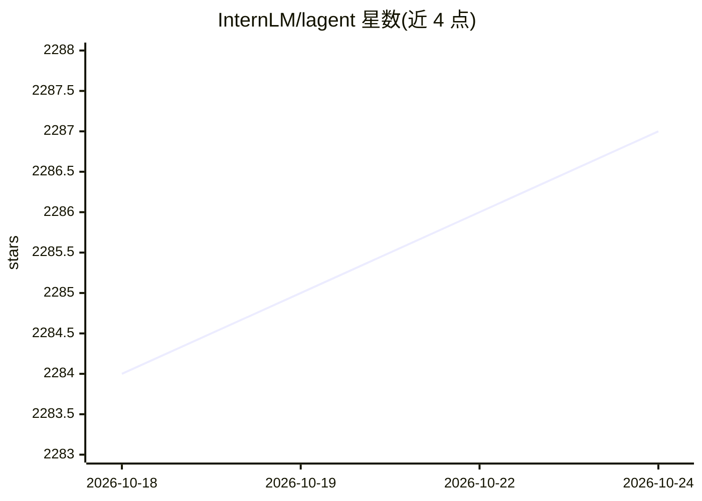

# InternLM/lagent

⭐ 2,287 · Python · Apache-2.0 · 推送 2026-10-19 · [GitHub](https://github.com/InternLM/lagent) · 组织维护 · 中文 README

**轻量级 LLM Agent 构建框架，供开发者搭建多智能体应用**

由 InternLM 团队维护的 Python 框架，借鉴 PyTorch 的分层设计：用户以类似神经网络层的方式组织 Agent 工作流并定义消息传递。Agent 间通过 AgentMessage 通信，内置记忆管理（state_dict 查看/重置）、消息聚合器（转换为 OpenAI 消息格式）、输出格式解析（ToolParser）与工具调用执行器（ActionExecutor，支持 IPython 解释器、WebBrowser 等）。各组件提供同步与异步（Async 前缀）双接口，支持 VllmModel、LMDeploy、GPTAPI 等多种 LLM 后端，附单 Agent 与多 Agent 示例。

## 筛选速览

| 维度 | 判定 | 备注 |
|---|---|---|
| AI 角色 | `ai-ecosystem` | LLM/agent 周边工具 |
| 许可风险 | `permissive` | Apache-2.0 |
| 部署形态 | `library` | 以包/库形式分发 |
| 模型依赖 | — | README 未给出锁定关系 |
| 硬件要求 | — | 无带数字的原话,不猜 |
| 安装摩擦 | `low` | 无编译、无系统依赖或容器化 |
| 成熟度 | — | 结构信号不足 |

## 能力要点

- 类 PyTorch 分层设计，Pythonic 方式定义 Agent 工作流与消息传递
- 同步/异步双接口（Agent/AsyncAgent、VllmModel/AsyncVllmModel 等）
- AgentMessage 统一通信结构，含记忆、聚合器、输出格式解析与工具执行器
- 内置 IPython 解释器、WebBrowser 等工具及自定义 Hook 机制

## 适用场景

- 构建通过编程解题的数学/代码 Agent
- 搭建自我迭代写作、信息检索与绘图的多 Agent 工作流
- 以会话隔离（session_id）方式并发运行多个独立 Agent

## 场景标签

`Agent 框架` `多智能体` · 领域:Agent 开发

## 证据(README 行号)

> L25: Lagent is inspired by the design philosophy of PyTorch. We expect that the analogy of neural network layers will ma
> L202:     title={{Lagent: InternLM} a lightweight open-source framework that allows users to efficiently build large lan

## 星数曲线

2026-10-18 2,284 → 2026-10-24 2,287（+3）

---
*卡片 v1 · prompt 1.4 · 生成 2026-10-21 · 置信度 high · 依据 README sha `c4f23de8708b` · [字段定义](../../DATASET.md)*
