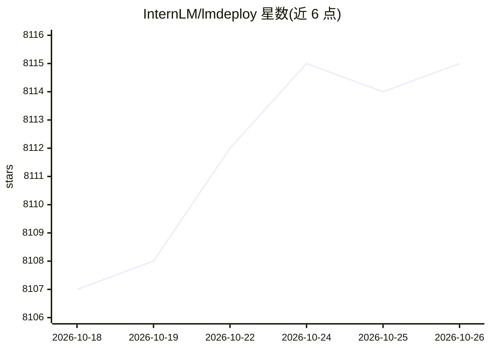

# InternLM/lmdeploy

⭐ 8,115 · Python · Apache-2.0 · 推送 2026-10-24 · [GitHub](https://github.com/InternLM/lmdeploy) · [官网](https://lmdeploy.readthedocs.io/en/latest) · 组织维护 · 中文 README

**LLM 压缩、部署与推理服务工具包（TurboMind/PyTorch 双引擎）**

由 MMRazor 与 MMDeploy 团队开发的 LLM 工具包，提供模型量化（weight-only/KV cache/AWQ/4bit）、离线批处理推理与多机多卡推理服务部署。内置 TurboMind 与 PyTorch 两个推理引擎，前者面向推理性能优化（persistent batch、blocked KV cache、tensor parallelism、CUDA kernels），后者纯 Python 实现以降低开发门槛。支持大量 LLM/VLM 模型（Llama、Qwen、InternLM、DeepSeek、gpt-oss 等），通过 pip 安装，预编译 wheel 基于 CUDA 12.8，另支持华为昇腾平台。

## 筛选速览

| 维度 | 判定 | 备注 |
|---|---|---|
| AI 角色 | `ai-ecosystem` | LLM/agent 周边工具 |
| 许可风险 | `permissive` | Apache-2.0 |
| 部署形态 | `library` | 以包/库形式分发 |
| 模型依赖 | — | README 未给出锁定关系 |
| 硬件要求 | — | 无带数字的原话,不猜 |
| 安装摩擦 | `medium` | 含编译或系统依赖之一 |
| 成熟度 | — | 结构信号不足 |

## 能力要点

- TurboMind 与 PyTorch 双推理引擎，覆盖性能优化与低门槛开发两种取向
- 支持 weight-only/KV cache/AWQ 等 4bit 量化与推理
- 多模型、多机、多卡推理服务与请求分发部署
- 支持 NVIDIA GPU 与华为昇腾（PyTorch 引擎）

## 适用场景

- 在生产环境部署 LLM/VLM 推理服务
- 对大模型做 4bit 量化以降低推理成本
- 离线批量跑 LLM/VLM 推理流水线

## 场景标签

`推理引擎` `模型量化` · 领域:训练与推理

## 证据(README 行号)

> L78: LMDeploy is a toolkit for compressing, deploying, and serving LLM, developed by the MMRazor and MMDeploy teams. It 
> L80: - **Efficient Inference**: LMDeploy delivers up to 1.8x higher request throughput than vLLM, by introducing key fea
> L172: LMDeploy has developed two inference engines - TurboMind and PyTorch, each with a different focus. The former stri

## 星数曲线

2026-10-18 8,107 → 2026-10-26 8,115（+8）

---
*卡片 v1 · prompt 1.4 · 生成 2026-10-20 · 置信度 high · 依据 README sha `46437525ec1a` · [字段定义](../../DATASET.md)*
