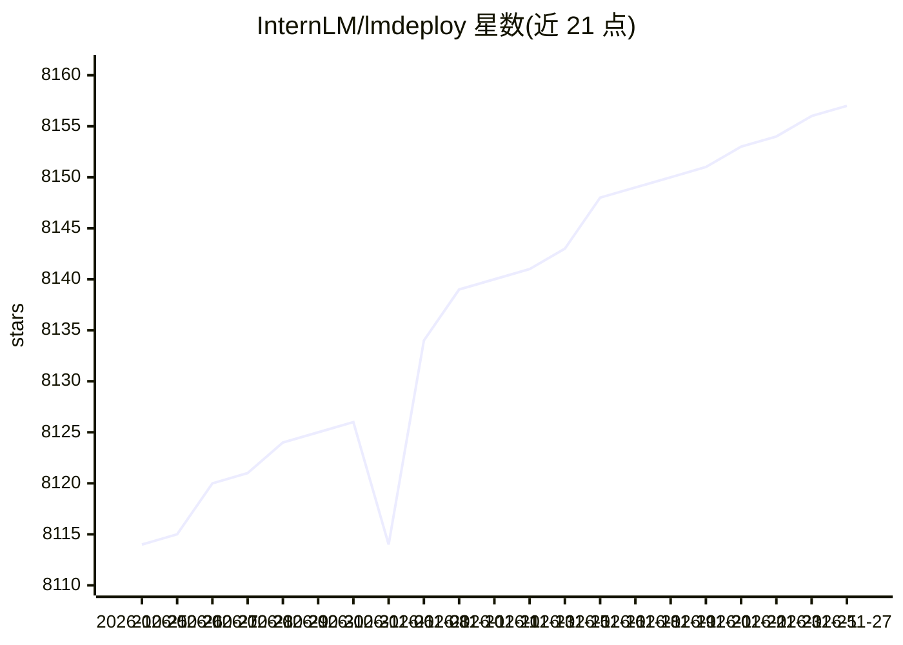

# InternLM/lmdeploy

⭐ 8,157 · Python · Apache-2.0 · 推送 2026-11-26 · [GitHub](https://github.com/InternLM/lmdeploy) · [官网](https://lmdeploy.readthedocs.io/en/latest) · 组织维护 · 中文 README

**LLM 压缩、部署与推理服务工具包**

由 MMRazor 与 MMDeploy 团队开发的 LLM 推理部署工具包，覆盖量化、离线批推理与在线服务。内置两个推理引擎：TurboMind 侧重性能优化（persistent batch、blocked KV cache、CUDA kernel），PyTorch 引擎纯 Python 实现便于开发者实验。支持 weight-only 与 KV cache 量化、AWQ、自动前缀缓存，提供多机多卡的多模型分发服务，支持大量 LLM 与 VLM 模型。pip 安装，默认 wheel 基于 CUDA 12.8 构建。

## 筛选速览

| 维度 | 判定 | 备注 |
|---|---|---|
| AI 角色 | `ai-ecosystem` | LLM/agent 周边工具 |
| 许可风险 | `permissive` | Apache-2.0 |
| 部署形态 | `library` | 以包/库形式分发 |
| 模型依赖 | — | README 未给出锁定关系 |
| 硬件要求 | — | 无带数字的原话,不猜 |
| 安装摩擦 | `medium` | 含编译或系统依赖之一 |
| 成熟度 | — | 结构信号不足 |

## 能力要点

- TurboMind 与 PyTorch 双推理引擎
- 支持 weight-only 与 KV cache 量化，兼容 AWQ
- 多模型、多机、多卡推理服务与 PD 分离部署（DeepSeek）
- 支持 LLM 与 VLM 离线推理 pipeline 及 serving

## 适用场景

- 把开源大模型量化后部署为推理服务
- 在多 GPU 环境下托管多个模型
- 离线批量推理生成文本

## 场景标签

`推理引擎` `模型量化` · 领域:训练与推理

## 证据(README 行号)

> L74: LMDeploy is a toolkit for compressing, deploying, and serving LLM, developed by the MMRazor and MMDeploy teams. It 
> L169: LMDeploy has developed two inference engines - TurboMind and PyTorch, each with a different focus. The former stri
> L177: It is recommended to install lmdeploy using pip in a conda environment (python 3.10 - 3.13):

## 星数曲线

2026-10-25 8,114 → 2026-11-27 8,157（+43）

---
*卡片 v1 · prompt 1.4 · 生成 2026-11-22 · 置信度 high · 依据 README sha `dd0e8266ec91` · [字段定义](../../DATASET.md)*
