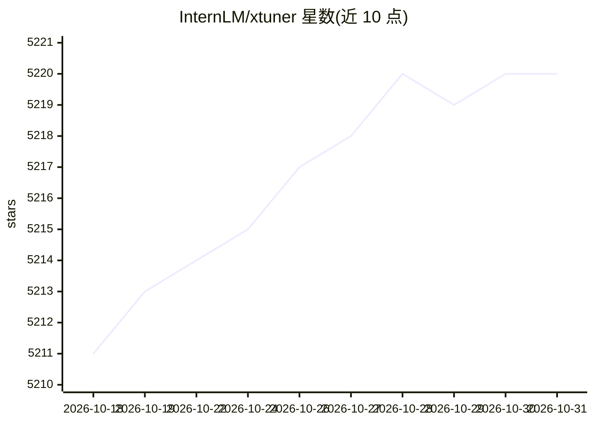

# InternLM/xtuner

⭐ 5,220 · Python · Apache-2.0 · 推送 2026-10-30 · [GitHub](https://github.com/InternLM/xtuner) · [官网](https://xtuner.readthedocs.io/zh-cn/latest/) · 组织维护 · 中文 README

**面向超大规模 MoE 模型的 LLM 训练引擎**

XTuner V1 是 InternLM 团队开源的 LLM 训练引擎，面向超大稠密与 MoE 模型的预训练、指令微调与强化学习。关键机制：Dropless 训练可在无专家并行下训练 200B MoE、600B 仅需节点内专家并行；通过内存优化支持 64k 长序列；宣称支持最高 1T 参数规模训练。支持 Intern S1/InternVL/Qwen3/GPT-OSS/DeepSeek V3/Kimi K2 等模型，覆盖 GPU(FP8/BF16)与 NPU(BF16)，推理集成支持 LMDeploy，vLLM/SGLang 在路线图。已实现 GRPO 与多模态预训练/微调，Apache 2.0 许可。

## 筛选速览

| 维度 | 判定 | 备注 |
|---|---|---|
| AI 角色 | `ai-ecosystem` | LLM/agent 周边工具 |
| 许可风险 | `permissive` | Apache-2.0 |
| 部署形态 | `library` | 以包/库形式分发 |
| 模型依赖 | — | README 未给出锁定关系 |
| 硬件要求 | — | 无带数字的原话,不猜 |
| 安装摩擦 | `low` | 无编译、无系统依赖或容器化 |
| 成熟度 | `idea` | |

## 能力要点

- Dropless 训练：200B MoE 无需专家并行，支持至 1T 参数规模
- 无需序列并行即可在 200B MoE 上训练 64k 长序列
- 支持 Intern S1/InternVL/Qwen3 MoE/GPT-OSS/DeepSeek V3/Kimi K2
- 已实现 GRPO 强化学习与多模态预训练/微调

## 适用场景

- 对超大规模 MoE 模型做预训练或指令微调
- 在 GPU 或 Ascend NPU 上做大规模 RLHF/GRPO 训练
- 训练视觉-语言多模态模型

## 场景标签

`模型训练` `微调` `强化学习` `多模态` · 领域:感知与多模态

## 证据(README 行号)

> L28: XTuner V1 is a next-generation LLM training engine specifically designed for ultra-large-scale MoE models. Unlike t
> L50: XTuner V1 is committed to continuously improving training efficiency for pre-training, instruction fine-tuning, and

## 星数曲线

2026-10-18 5,211 → 2026-10-31 5,220（+9）

---
*卡片 v1 · prompt 1.4 · 生成 2026-10-20 · 置信度 high · 依据 README sha `ebea8397bed4` · [字段定义](../../DATASET.md)*
