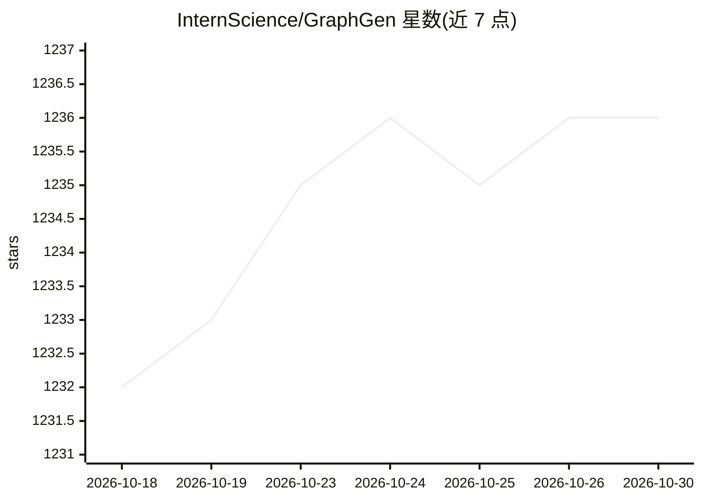

# InternScience/GraphGen

⭐ 1,236 · Python · Apache-2.0 · 推送 2026-08-17 · [GitHub](https://github.com/InternScience/GraphGen) · [官网](https://chenzihong.gitbook.io/graphgen-cookbook/) · 组织维护 · 中文 README

**知识图谱引导的 LLM 训练合成数据生成框架**

面向 LLM 微调场景的合成数据生成框架：从源文本构建细粒度知识图谱，用期望校准误差识别 LLM 知识缺口，优先针对长尾高价值知识生成 QA 对；支持多跳邻域采样与风格控制生成，输出原子、聚合、CoT、多选、填空、判断、VQA 等多种题型。支持 vLLM/SGLang/HF 推理后端、Ollama/OpenAI 客户端，数据源覆盖文件、数据库与搜索引擎；生成后可配合 LLaMA-Factory、xtuner 微调。提供 PyPI、源码与 Docker 三种运行方式及 Gradio 演示。

## 筛选速览

| 维度 | 判定 | 备注 |
|---|---|---|
| AI 角色 | `ai-ecosystem` | LLM/agent 周边工具 |
| 许可风险 | `permissive` | Apache-2.0 |
| 部署形态 | `self-host` | docker 或自建部署 |
| 模型依赖 | local-ok | 支持本地模型 |
| 硬件要求 | — | 无带数字的原话,不猜 |
| 安装摩擦 | `low` | 无编译、无系统依赖或容器化 |
| 成熟度 | — | 结构信号不足 |

## 能力要点

- 知识图谱+校准误差定位 LLM 知识缺口，优先生成长尾知识 QA
- 支持 CoT/原子/聚合/多跳/VQA/多选/填空/判断等多题型合成
- 推理后端覆盖 vLLM、SGLang、HF、Ollama、OpenAI 等
- 数据源支持文件、UniProt/NCBI/RNAcentral 数据库与搜索引擎

## 适用场景

- 为自己的 LLM 微调合成领域 QA 训练数据
- 针对模型长尾知识缺口定向生成训练样本
- 教育场景合成选择题、填空题等测评数据
- 知识密集领域构造 RLVR 可验证数据

## 场景标签

`知识图谱` · 领域:知识与检索

## 证据(README 行号)

> L32: GraphGen is a framework for synthetic data generation guided by knowledge graphs. Please check the **paper** and be
> L37: After data generation, you can use LLaMA-Factory and xtuner to finetune your LLMs.

## 星数曲线

2026-10-18 1,232 → 2026-10-30 1,236（+4）

---
*卡片 v1 · prompt 1.4 · 生成 2026-10-21 · 置信度 high · 依据 README sha `2263c5e6551e` · [字段定义](../../DATASET.md)*
