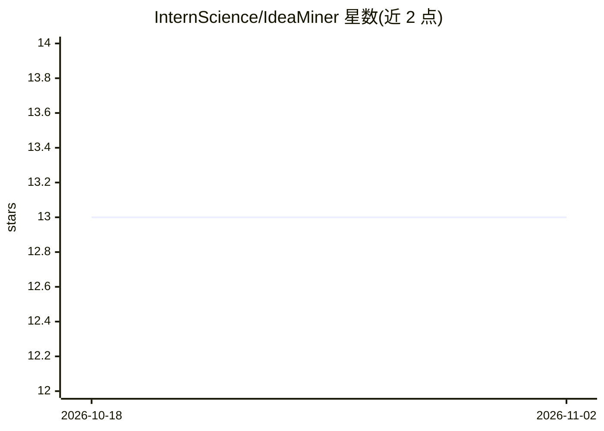

# InternScience/IdeaMiner

⭐ 13 · Python · MIT · 推送 2026-03-02 · [GitHub](https://github.com/InternScience/IdeaMiner) · [官网](https://discovery-ideaminer.intern-ai.org.cn/) · 组织维护 · 中文 README

**面向科研人员的两阶段 LLM 研究问题生成与评估流水线**

IdeaMiner 用 LLM agent 生成并评估新颖科研问题，分两步运行：第一步按领域/关键词/研究类型/粒度的配置文件由 LLM 生成 30 个问题；第二步用 embedding 余弦相似度去重，再由多个 LLM 评分模型配合 web_search 工具多轮打分，输出按共识分排序的问题列表，每条含背景、意义、方法论及新颖性/可行性/重要性评分。依赖任意 OpenAI 兼容 API 与 Tavily 搜索 key，另提供免搭建的在线平台。

## 筛选速览

| 维度 | 判定 | 备注 |
|---|---|---|
| AI 角色 | `ai-native` | 本体是模型或模型工具 |
| 许可风险 | `permissive` | MIT |
| 部署形态 | `library` | 以包/库形式分发 |
| 模型依赖 | — | README 未给出锁定关系 |
| 硬件要求 | — | 无带数字的原话,不猜 |
| 安装摩擦 | `low` | 无编译、无系统依赖或容器化 |
| 成熟度 | — | 结构信号不足 |

## 能力要点

- 两阶段流水线：生成 30 个问题 → embedding 去重 → 多模型多轮评分排序
- 评分 agent 可调用 web_search 工具结合当前文献
- 每个问题含 background/significance/methodology 及三项评分
- 提供在线平台，可按领域与经验级别个性化浏览问题

## 适用场景

- 科研选题时批量获取并筛选候选研究问题
- 按学科领域与关键词定制生成研究问题
- 通过在线平台浏览和收藏各领域 AI 生成的研究问题

## 场景标签

`科研工具` · 领域:学习与行业

## 证据(README 行号)

> L2:  A two-stage LLM pipeline for generating and evaluating novel scientific research questions.
> L7: IdeaMiner is a two-stage pipeline for generating and evaluating novel scientific research questions using LLM agents

## 星数曲线

2026-10-18 13 → 2026-11-02 13（+0）

---
*卡片 v1 · prompt 1.4 · 生成 2026-10-31 · 置信度 high · 依据 README sha `4b17f3015809` · [字段定义](../../DATASET.md)*
