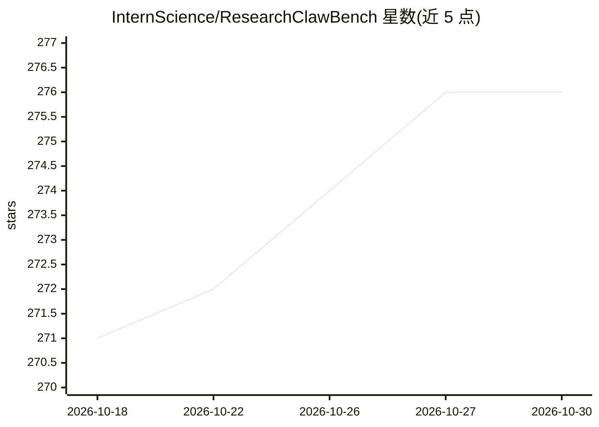

# InternScience/ResearchClawBench

⭐ 276 · Jupyter Notebook · MIT · 推送 2026-10-28 · [GitHub](https://github.com/InternScience/ResearchClawBench) · [官网](https://internscience.github.io/ResearchClawBench-Home/) · 组织维护 · 中文 README

**评测 AI 编码 agent 自主科研能力的基准（40 任务/10 学科）**

评测 AI 编码 agent 能否独立完成科研的基准：40 个来自 10 个学科已发表论文的真实任务，每题由领域专家提供数据集、任务说明与带权重的 rubric（检查清单）。两阶段流程——agent 在沙盒工作区自主写代码、分析数据并产出研究报告（阶段一），随后由 LLM 评审按双模式 rubric 对照原论文打分（阶段二），50 分约等于复现原论文、70+ 为超越。内置支持 Claude Code、Codex CLI、OpenClaw 等多种 agent，附带排行榜、Flask 流式 UI 与 rcb-eval 命令行评测工具。

## 筛选速览

| 维度 | 判定 | 备注 |
|---|---|---|
| AI 角色 | `ai-ecosystem` | LLM/agent 周边工具 |
| 许可风险 | `permissive` | MIT |
| 部署形态 | `library` | 以包/库形式分发 |
| 模型依赖 | — | README 未给出锁定关系 |
| 硬件要求 | — | 无带数字的原话,不猜 |
| 安装摩擦 | `low` | 无编译、无系统依赖或容器化 |
| 成熟度 | — | 结构信号不足 |

## 能力要点

- 40 个来自 10 学科已发表论文的真实科研任务
- 两阶段流程：自主研究 + 基于 rubric 的 LLM 评审打分
- 内置支持 Claude Code、Codex CLI、OpenClaw 等多 agent，可一行接入自定义 agent
- Flask + 原生 JS 轻量依赖，含实时流式 UI 与 rcb-eval 命令行评测工具

## 适用场景

- 评测自主科研 agent 的复现与发现能力
- 在同一基准下比较不同 LLM 与 agent 的科研表现
- 通过 Hugging Face 提交社区新任务

## 场景标签

`模型评测` `科研工具` · 领域:评测与运维

## 证据(README 行号)

> L18: ResearchClawBench is a benchmark that measures whether AI coding agents can **independently conduct scientific rese
> L26:  🔄 Two-Stage Pipeline Autonomous research + rigorous peer-review-style evaluation
> L46: - **Fine-grained, multimodal scoring.** A weighted rubric (checklist) with text and image criteria, judged by an LL

## 星数曲线

2026-10-18 271 → 2026-10-30 276（+5）

---
*卡片 v1 · prompt 1.4 · 生成 2026-10-22 · 置信度 high · 依据 README sha `cf23fa509498` · [字段定义](../../DATASET.md)*
