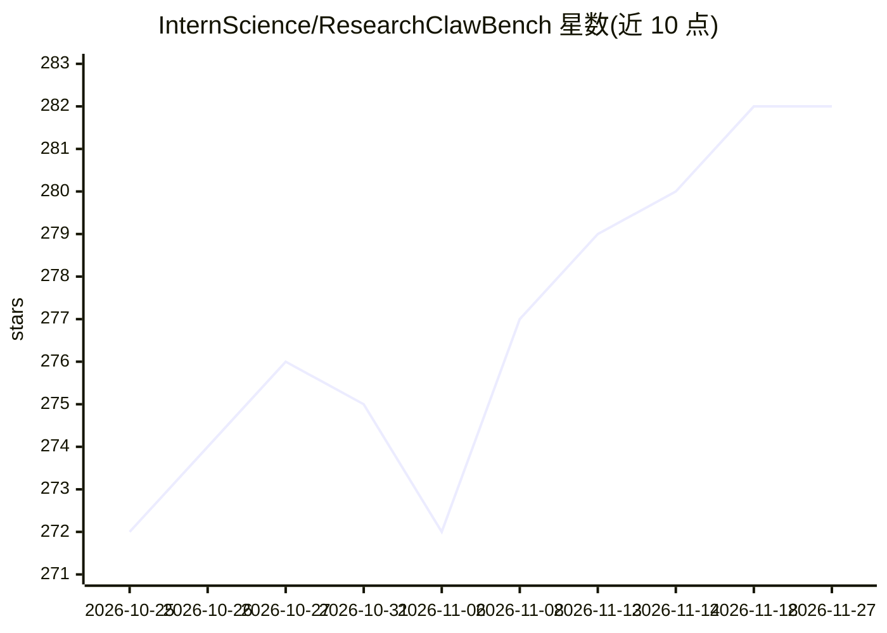

# InternScience/ResearchClawBench

⭐ 282 · Jupyter Notebook · MIT · 推送 2026-10-28 · [GitHub](https://github.com/InternScience/ResearchClawBench) · [官网](https://internscience.github.io/ResearchClawBench-Home/) · 组织维护

**评测 AI 编码 agent 能否独立完成科研并对照人类论文打分的基准**

ResearchClawBench 是一个两阶段基准：40 个来自已发表论文、覆盖 10 个学科的真实科研任务，AI agent 在给定科研工作区中自主探索数据、写代码、产出研究报告；第二阶段由 LLM 评委按专家编制的加权 checklist（含文本与图像双模态条目）对照原论文逐项打分，50 分以上表示复现原文，70 分以上表示超越原文。内置支持 Claude Code、Codex CLI、OpenClaw、ResearchClaw 等多种 agent，可一行接入自定义 agent；UI 为 Flask + 原生 JS 的轻量实现，支持实时流式查看 agent 运行，结果发布于公开排行榜。

## 筛选速览

| 维度 | 判定 | 备注 |
|---|---|---|
| AI 角色 | `ai-ecosystem` | LLM/agent 周边工具 |
| 许可风险 | `permissive` | MIT |
| 部署形态 | `library` | 以包/库形式分发 |
| 模型依赖 | — | README 未给出锁定关系 |
| 硬件要求 | — | 无带数字的原话,不猜 |
| 安装摩擦 | `low` | 无编译、无系统依赖或容器化 |
| 成熟度 | — | 结构信号不足 |

## 能力要点

- 40 个真实科研任务覆盖 10 个学科，数据集由领域专家从已发表论文整理
- 两阶段流水线：自主科研 + 同行评审式 LLM 评分（文本+图像双模态 checklist）
- Agent 无关设计，内置 Claude Code、Codex CLI、OpenClaw、ResearchClaw 等，可一行接入自定义 agent
- 提供 rcB-eval 命令行评测工作流与 Hugging Face 数据集镜像及任务下载脚本

## 适用场景

- 测试自己的科研 agent 能否独立复现并超越已发表论文结果
- 在统一工作流下横向评测不同 LLM/agent 的自主科研能力
- 为 AI4Science 研究获取带专家标注 rubric 的科研任务数据集

## 场景标签

`模型评测` `科研工具` · 领域:评测与运维

## 证据(README 行号)

> L18: ResearchClawBench is a benchmark that measures whether AI coding agents can **independently conduct scientific rese
> L46: - **Fine-grained, multimodal scoring.** A weighted rubric (checklist) with text and image criteria, judged by an LL
> L47: - **Agent-agnostic.** Ships with built-in support for Claude Code, Codex CLI, ARIS Codex, OpenClaw, Nanobot, EvoSci

## 星数曲线

2026-10-25 272 → 2026-11-27 282（+10）

---
*卡片 v1 · prompt 1.4 · 生成 2026-11-25 · 置信度 mid · 依据 README sha `7bf15a8d1c4e` · [字段定义](../../DATASET.md)*
