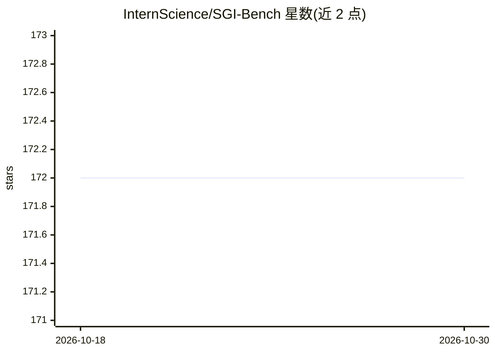

# InternScience/SGI-Bench

⭐ 172 · Python · MIT · 推送 2026-06-02 · [GitHub](https://github.com/InternScience/SGI-Bench) · [官网](https://internscience.github.io/SGI-Page/) · 组织维护 · 中文 README

**评测 LLM 科学通用智能的科学家对齐基准与评测框架**

SGI-Bench 是面向科学通用智能（SGI）的 LLM 评测基准：覆盖深度研究、想法生成、干/湿实验与实验推理四类任务，横跨 10 个学科、1,000+ 专家构建样本（灵感来自 Science 125 个大问题）。提供 agent 化评测框架（问题选择→指标定制→预测评测→报告生成，含网络搜索、PDF 解析、Python 解释器等工具池）与多指标协议，并附测试时强化学习（TTRL）方法。数据集在 Hugging Face 上以 gated 形式发布，需设置 HF_TOKEN；评测通过 git clone 源码加 conda 环境分任务运行。

## 筛选速览

| 维度 | 判定 | 备注 |
|---|---|---|
| AI 角色 | `ai-ecosystem` | LLM/agent 周边工具 |
| 许可风险 | `permissive` | MIT |
| 部署形态 | `library` | 以包/库形式分发 |
| 模型依赖 | — | README 未给出锁定关系 |
| 硬件要求 | — | 无带数字的原话,不猜 |
| 安装摩擦 | `low` | 无编译、无系统依赖或容器化 |
| 成熟度 | — | 结构信号不足 |

## 能力要点

- 四类科学家对齐任务：深度研究/想法生成/干湿实验/实验推理
- 10 学科、1,000+ 专家构建样本，含难度过滤（剔除 >50% 强 LLM 可解样本）
- agent 化四阶段评测框架与可定制指标（EM/SLA、PassAll@k 等）
- 测试时强化学习 TTRL：无标注下将想法生成新颖性 49.36 提升至 62.06

## 适用场景

- 评测 LLM 在完整科学探究周期上的能力
- 对比不同模型在深度研究与实验代码生成上的表现
- 基于 agent 框架运行自定义科学评测指标

## 场景标签

`模型评测` · 领域:评测与运维

## 证据(README 行号)

> L12: Scientist-aligned benchmark for evaluating Scientific General Intelligence (SGI) across the full inquiry cycle: Del
> L61: - **Four Stages**: Question Selection → Metric Customization → Predict & Eval → Report Generation
> L66: This agent‑based stack formalizes scoring into traceable stages, improves reproducibility, mitigates evaluator–mode

## 星数曲线

2026-10-18 172 → 2026-10-30 172（+0）

---
*卡片 v1 · prompt 1.4 · 生成 2026-10-22 · 置信度 mid · 依据 README sha `e015d8d70c1f` · [字段定义](../../DATASET.md)*
