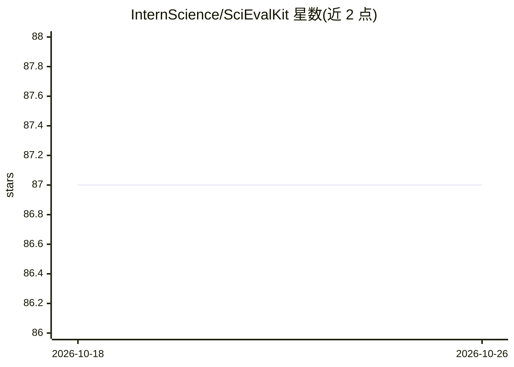

# InternScience/SciEvalKit

⭐ 87 · Python · Apache-2.0 · 推送 2026-08-30 · [GitHub](https://github.com/InternScience/SciEvalKit) · 组织维护 · 中文 README

**评测大模型科学智能的统一工具包与排行榜**

OpenCompass 体系下的科学能力评测框架：覆盖科学知识理解、代码生成、符号推理、假设生成及多模态感知/推理/理解七个维度，横跨生命科学、天文、地学、化学、材料、物理六个学科。提供数据集构建、prompt 工程、推理与专家对齐打分的一体化流水线，支持文本、代码与图像输入，代码任务通过沙箱单元测试评分，开放回答可回退 LLM-as-judge，无 API key 时回退规则打分。基于 VLMEvalKit 构建，可通过 git clone 与 pip 安装，支持 API 模型与本地 GPU 模型评测，并维护实时同步的排行榜。

## 筛选速览

| 维度 | 判定 | 备注 |
|---|---|---|
| AI 角色 | `ai-ecosystem` | LLM/agent 周边工具 |
| 许可风险 | `permissive` | Apache-2.0 |
| 部署形态 | `library` | 以包/库形式分发 |
| 模型依赖 | local-ok | 支持本地模型 |
| 硬件要求 | — | 无带数字的原话,不猜 |
| 安装摩擦 | `low` | 无编译、无系统依赖或容器化 |
| 成熟度 | — | 结构信号不足 |

## 能力要点

- 七个科学能力维度 × 六大学科的基准套件
- 沙箱单元测试执行式代码评分
- 多模态（文本/代码/图像）输入与 LLM-as-judge 回退打分
- 支持 API 模型（OpenAI/Google/DashScope）与本地 GPU 模型评测

## 适用场景

- 评测自研或第三方大模型的科学领域能力
- 对比通用基准与科学基准的能力差距
- 通过 PR 提交基准并上官方排行榜

## 场景标签

`模型评测` · 领域:评测与运维

## 证据(README 行号)

> L19: **SciEval** is an open‑source evaluation framework and leaderboard aimed at measuring the **scientific intelligence
> L25: - **Capability‑oriented & reproducible ▸** A unified toolkit for **dataset construction, prompt engineering, infere

## 星数曲线

2026-10-18 87 → 2026-10-26 87（+0）

---
*卡片 v1 · prompt 1.4 · 生成 2026-10-23 · 置信度 high · 依据 README sha `b103d71de378` · [字段定义](../../DATASET.md)*
