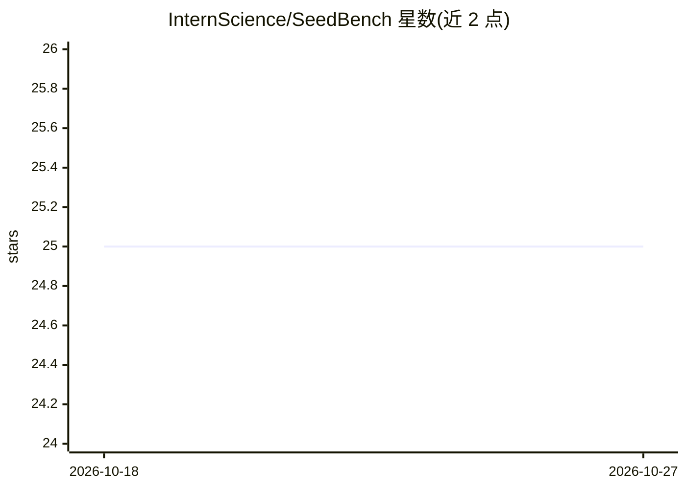

# InternScience/SeedBench

⭐ 25 · Python · GPL-3.0 · 推送 2025-12-19 · [GitHub](https://github.com/InternScience/SeedBench) · 组织维护 · 中文 README

**种子科学（水稻育种）多任务 LLM 评测基准数据集与评测代码**

ACL 2025 论文配套的多任务基准，用于评测大语言模型在种子科学（聚焦水稻育种）上的表现：覆盖基因信息检索、基因功能调控分析、农艺性状优化育种三个阶段，含 2,264 道专家验证的双语题目，分 11 种任务类型（选择、填空、生成、摘要、阅读理解等）与 10 个子类，语料为 30.8 万篇文献清洗出的 11 亿 token。仓库提供数据集、基座/SFT 模型评测代码，基于 OpenCompass 运行评测；已评测 26 个 LLM，未来计划扩展玉米、大豆、小麦。

## 筛选速览

| 维度 | 判定 | 备注 |
|---|---|---|
| AI 角色 | `ai-knowledge` | 知识聚合/清单类 |
| 许可风险 | `viral` | GPL-3.0 |
| 部署形态 | `library` | 以包/库形式分发 |
| 模型依赖 | — | README 未给出锁定关系 |
| 硬件要求 | — | 无带数字的原话,不猜 |
| 安装摩擦 | `low` | 无编译、无系统依赖或容器化 |
| 成熟度 | — | 结构信号不足 |

## 能力要点

- 2,264 道专家验证的中英双语题目，11 种任务类型
- 覆盖育种三阶段：基因检索、功能分析、性状优化育种
- 提供 base_model_eval 与 sft_model_eval（one-shot/zero-shot）评测代码
- 基于 OpenCompass + ModelScope 运行评测

## 适用场景

- 评测 LLM 在农业育种领域的专业能力
- 获取水稻育种领域的中英双语基准数据集
- 复现论文中对 26 个 LLM 的评测结果

## 场景标签

`模型评测` · 领域:评测与运维

## 证据(README 行号)

> L6: **SeedBench** is the first multi-task benchmark designed to evaluate large language models (LLMs) in seed science, f
> L18: Built with domain experts, SeedBench features **2,264 expert-validated questions** across 11 task types and 10 subc
> L23: - **Questions**: 2,264 across 11 task types, bilingual (English/Chinese), expert-validated.

## 星数曲线

2026-10-18 25 → 2026-10-27 25（+0）

---
*卡片 v1 · prompt 1.4 · 生成 2026-10-27 · 置信度 mid · 依据 README sha `fd9943226140` · [字段定义](../../DATASET.md)*
