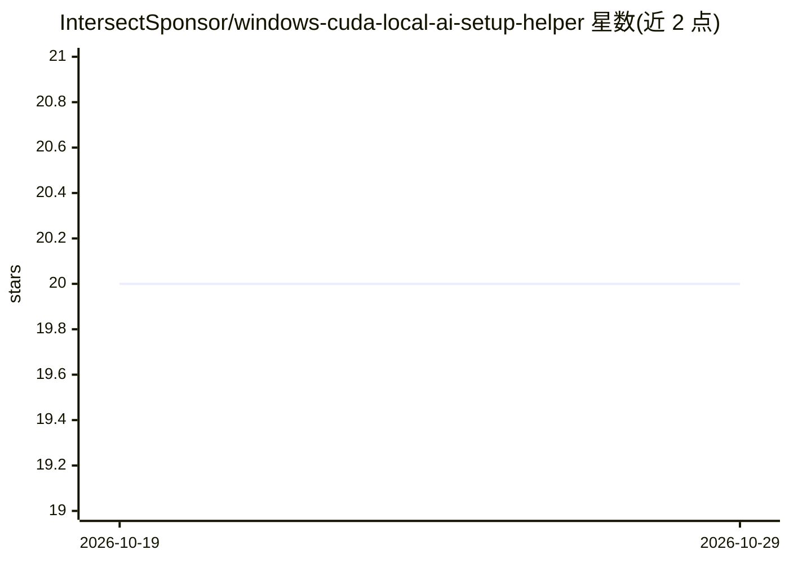

# IntersectSponsor/windows-cuda-local-ai-setup-helper

⭐ 20 · CSS · MIT · 推送 2026-10-19 · [GitHub](https://github.com/IntersectSponsor/windows-cuda-local-ai-setup-helper) · 个人维护

**Windows 本地 AI 的 CUDA 环境配置与恢复工具**

面向 Windows 用户的独立下载型工具：围绕 CUDA 安装、NVIDIA 本地 AI 与 CUDA 环境组织配置工作流，提供可复用配置档、变更前备份、恢复回滚等步骤，并以选择/检测→分析→保存/应用→验证→恢复的流程组织操作。以 GitHub Releases 的 ZIP 压缩包分发，解压后运行 exe。仓库声明非 Ollama/NVIDIA/AMD/微软官方工具，不含商业模型。

## 筛选速览

| 维度 | 判定 | 备注 |
|---|---|---|
| AI 角色 | `ai-ecosystem` | LLM/agent 周边工具 |
| 许可风险 | `permissive` | MIT |
| 部署形态 | `desktop` | 安装包/桌面程序 |
| 模型依赖 | — | README 未给出锁定关系 |
| 硬件要求 | — | 无带数字的原话,不猜 |
| 安装摩擦 | `medium` | 含编译或系统依赖之一 |
| 成熟度 | — | 结构信号不足 |

## 能力要点

- CUDA 安装与环境配置工作流组织
- 变更前备份与可复用配置档
- 恢复回滚工作流
- ZIP 压缩包 + exe 形式的 Windows 分发

## 适用场景

- 在 Windows 上配置 CUDA/cuDNN 环境
- 本地 AI 运行环境出问题时按步骤排查与恢复
- 保存已知良好的配置以便回滚

## 场景标签

 · 领域:本地 AI 基础设施/环境配置

## 证据(README 行号)

> L19: **Windows CUDA Local AI Setup Helper** is designed to organize a Windows workflow around **cuda setup**, **nvidia l
> L46: 4. **Verify** — restart the affected local-AI runtime when necessary.

## 星数曲线

2026-10-19 20 → 2026-10-29 20（+0）

---
*卡片 v1 · prompt 1.4 · 生成 2026-10-28 · 置信度 mid · 依据 README sha `cfb9686abd04` · [字段定义](../../DATASET.md)*
