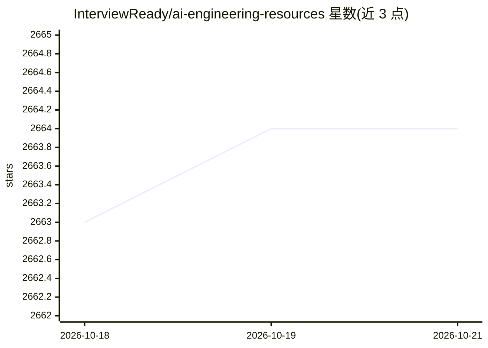

# InterviewReady/ai-engineering-resources

⭐ 2,664 · 推送 2025-11-19 · [GitHub](https://github.com/InterviewReady/ai-engineering-resources) · [官网](https://interviewready.io) · 组织维护

**软件工程师转型 AI 工程师的论文与资源清单**

由 InterviewReady 维护的研究资源清单：按 Tokenization、向量表示、基础设施、核心架构、MoE、RLHF、Chain of Thought、推理、优化、蒸馏、SSM、图像/视频 Transformer、上下文工程等约 20 个主题组织论文条目（含 BERT、Attention is All You Need、Mamba、DeepSeek R1 等），面向希望从软件工程转入 AI 工程方向的学习者，文末附视频课程链接。条目仅为标题列举，不含摘要或代码。

## 筛选速览

| 维度 | 判定 | 备注 |
|---|---|---|
| AI 角色 | `ai-knowledge` | 知识聚合/清单类 |
| 许可风险 | `none` | — |
| 部署形态 | `None` |  |
| 模型依赖 | — | README 未给出锁定关系 |
| 硬件要求 | — | 无带数字的原话,不猜 |
| 安装摩擦 | `low` | 无编译、无系统依赖或容器化 |
| 成熟度 | — | 结构信号不足 |

## 能力要点

- 约 20 个主题分类组织 AI 工程论文条目
- 覆盖架构、推理、优化、SSM、多模态等方向
- 附 AI 工程视频课程链接

## 适用场景

- 软件工程师按主题系统学习 AI 工程论文
- 查找 LLM 推理与优化方向的代表性研究

## 场景标签

`精选清单` · 领域:学习与行业

## 证据(README 行号)

> L1: # AI Engineering Transition Path
> L2: Research papers for software engineers to transition to AI Engineering

## 星数曲线

2026-10-18 2,663 → 2026-10-21 2,664（+1）

---
*卡片 v1 · prompt 1.4 · 生成 2026-10-21 · 置信度 high · 依据 README sha `5ae54915b9b0` · [字段定义](../../DATASET.md)*
