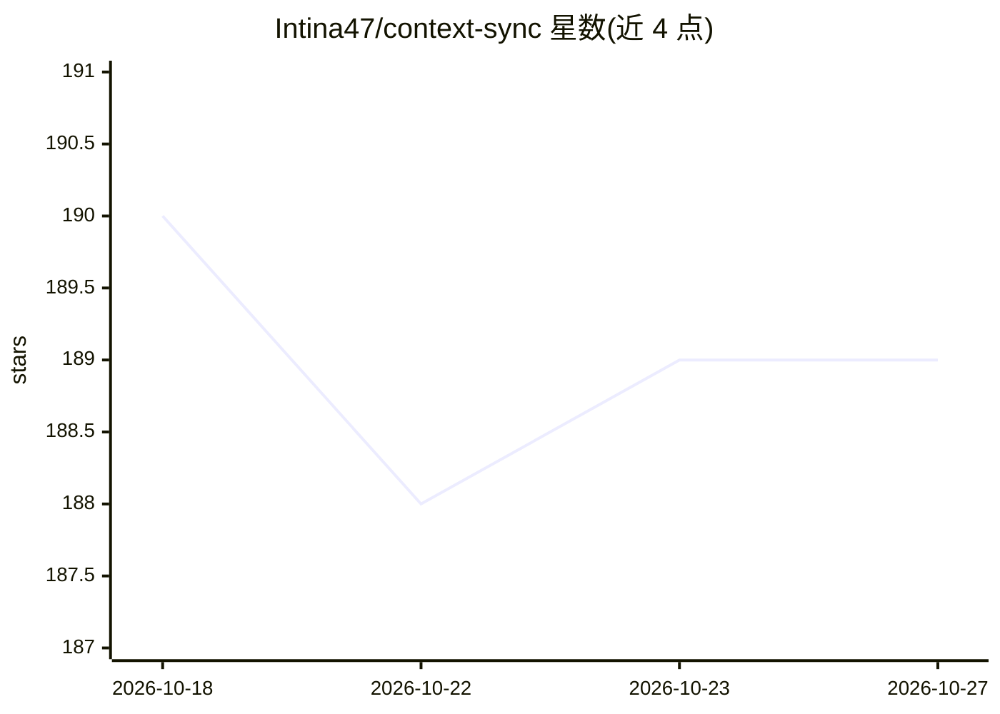

# Intina47/context-sync

⭐ 189 · TypeScript · MIT · 推送 2026-04-11 · [GitHub](https://github.com/Intina47/context-sync) · 个人维护

**面向 AI 编码工具的本地持久项目记忆 MCP 服务器**

通过 MCP 协议为 AI 编码 agent 提供跨会话的本地持久记忆层：存储项目身份、技术栈、决策、约束等信息，提供 set_project/remember/recall/read_file/search/structure/git/notion 等 9 个工具。支持 git 仓库钩子自动捕获上下文（post-commit/pre-push 等），Notion 集成为只读。数据存于本地 SQLite。全局 npm 安装时自动配置，支持 Claude Desktop、Cursor、Copilot、Codex CLI、Zed 等 11 个平台。

## 筛选速览

| 维度 | 判定 | 备注 |
|---|---|---|
| AI 角色 | `ai-ecosystem` | LLM/agent 周边工具 |
| 许可风险 | `permissive` | MIT |
| 部署形态 | `library` | 以包/库形式分发 |
| 模型依赖 | — | README 未给出锁定关系 |
| 硬件要求 | — | 无带数字的原话,不猜 |
| 安装摩擦 | `low` | 无编译、无系统依赖或容器化 |
| 成熟度 | — | 结构信号不足 |

## 能力要点

- 9 个 MCP 工具：记忆存取、文件读取、搜索、结构探索、git 上下文
- git 钩子自动捕获上下文，已有钩子先备份
- 本地 SQLite 存储，可用 CLI 或环境变量自定义路径
- 全局安装自动配置，覆盖 11 个 AI 编码平台

## 适用场景

- 让编码 agent 在新会话恢复项目决策与上下文
- 通过 git 钩子自动沉淀提交/合并中的项目上下文
- 在 Claude Desktop/Cursor 等工具中检索本地项目记忆

## 场景标签

`Agent 记忆` · 领域:Agent 开发

## 证据(README 行号)

> L3: Local-first project memory for AI coding tools over MCP.
> L16: Context Sync is built for session continuity. Instead of relying on a model to remember earlier conversations, it s
> L18: The current core tools are:

## 星数曲线

2026-10-18 190 → 2026-10-27 189（-1）

---
*卡片 v1 · prompt 1.4 · 生成 2026-10-22 · 置信度 high · 依据 README sha `a6d57ab69ca2` · [字段定义](../../DATASET.md)*
