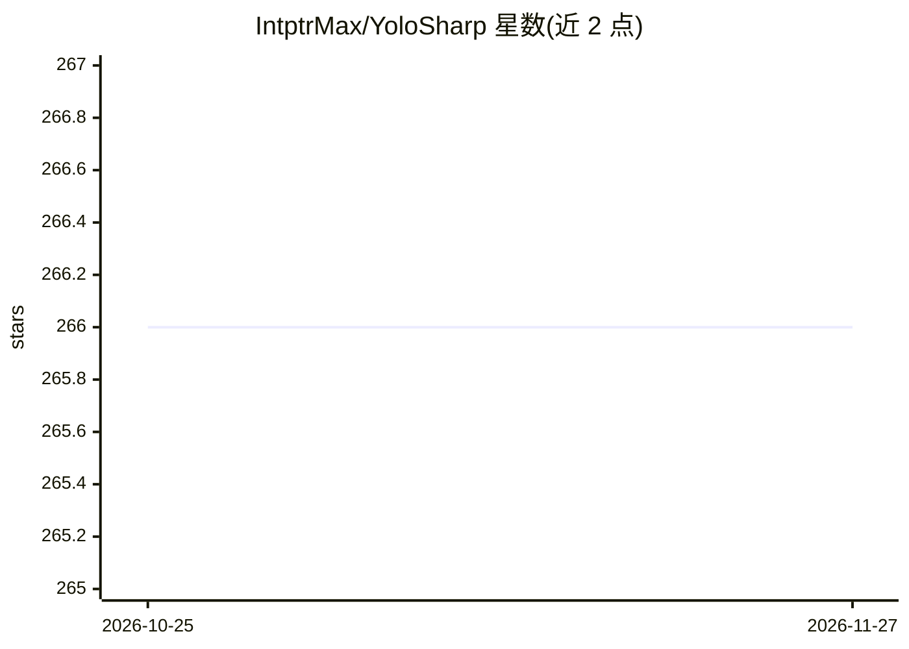

# IntptrMax/YoloSharp

⭐ 266 · C# · Apache-2.0 · 推送 2026-11-17 · [GitHub](https://github.com/IntptrMax/YoloSharp) · 个人维护

**纯 C#/.NET 训练与推理 YOLO 模型的库**

基于 TorchSharp（LibTorch 绑定）的 C# YOLO 实现，覆盖训练、验证、预测全流程，无需 Python 环境。支持 YOLOv5/v5u/v8/v9/v11/v12 五类模型，任务包括检测、分割、OBB、姿态估计与分类；内置 LetterBox/Mosaic4 增强、GPU 加速 NMS、EMA、早停与混合精度训练，并可导出动态 batch 的 ONNX 供 ONNX Runtime/OpenVINO/TensorRT 部署。通过 NuGet 分发，需额外安装 LibTorch 包（CPU 或 CUDA 版）与 OpenCvSharp4.runtime。

## 筛选速览

| 维度 | 判定 | 备注 |
|---|---|---|
| AI 角色 | `ai-native` | 本体是模型或模型工具 |
| 许可风险 | `permissive` | Apache-2.0 |
| 部署形态 | `None` |  |
| 模型依赖 | local-ok | 支持本地模型 |
| 硬件要求 | — | 无带数字的原话,不猜 |
| 安装摩擦 | `medium` | 含编译或系统依赖之一 |
| 成熟度 | — | 结构信号不足 |

## 能力要点

- 100% C# 实现，训练/验证/预测全流程无需 Python
- 支持 YOLOv5/v5u/v8/v9/v11/v12 与 5 种任务类型（检测/分割/OBB/姿态/分类）
- 导出单文件动态 batch ONNX，兼容 ONNX Runtime/OpenVINO/TensorRT
- 可加载 Ultralytics YOLO 官方权重及转换后的 YOLOv12 检查点

## 适用场景

- 在 .NET 后端或桌面应用中集成目标检测推理
- 用 C# 训练自定义数据集的 YOLO 模型
- 将训练好的模型导出 ONNX 部署到云端或边缘设备

## 场景标签

`目标检测` `推理引擎` `微调` · 领域:感知与多模态

## 证据(README 行号)

> L3: **Train and run YOLO models in pure C# with TorchSharp.**
> L9: - **Full pipeline support** – Train, validate, and predict with your own custom models.
> L11: - **All task types** – Object detection, segmentation, oriented bounding boxes (OBB), pose estimation (keypoints), 

## 星数曲线

2026-10-25 266 → 2026-11-27 266（+0）

---
*卡片 v1 · prompt 1.4 · 生成 2026-11-25 · 置信度 high · 依据 README sha `125fefa718b5` · [字段定义](../../DATASET.md)*
