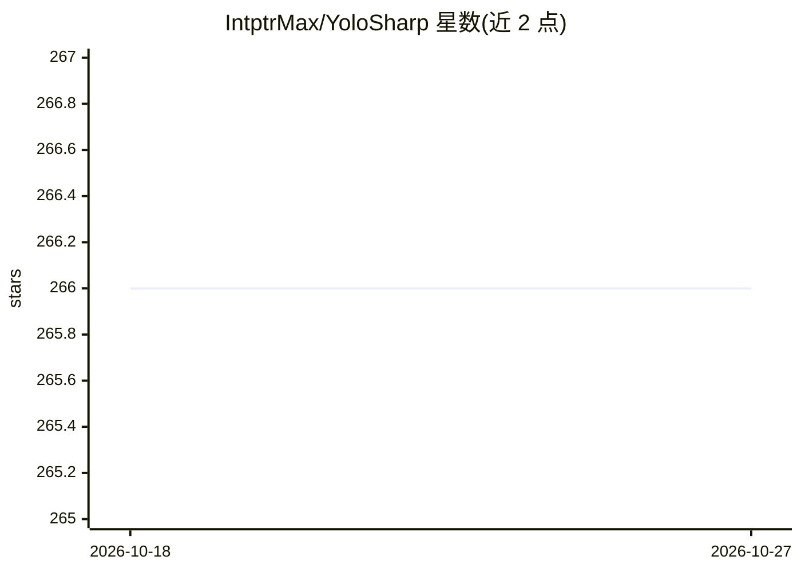

# IntptrMax/YoloSharp

⭐ 266 · C# · Apache-2.0 · 推送 2026-10-13 · [GitHub](https://github.com/IntptrMax/YoloSharp) · 个人维护

**纯 C# 训练与运行 YOLO 模型的 .NET 库，无需 Python**

基于 TorchSharp（LibTorch 绑定）的 YOLO 纯 C# 实现：支持 YOLOv5/v5u/v8/v11/v12 的训练、验证与预测，覆盖检测、分割、旋转框（OBB）、姿态估计与分类任务，内置 LetterBox/Mosaic4 增强、GPU 加速 NMS，可加载 Ultralytics .pt 权重。面向希望在 .NET 生态内完成深度学习全流程、避免 Python 运行时的 C# 开发者。需另配 LibTorch 包（CPU 或 CUDA）与 OpenCvSharp4 运行时，支持 .NET 6+ 与 Net Standard 2.0。

## 筛选速览

| 维度 | 判定 | 备注 |
|---|---|---|
| AI 角色 | `ai-native` | 本体是模型或模型工具 |
| 许可风险 | `permissive` | Apache-2.0 |
| 部署形态 | `None` |  |
| 模型依赖 | — | README 未给出锁定关系 |
| 硬件要求 | — | 无带数字的原话,不猜 |
| 安装摩擦 | `medium` | 含编译或系统依赖之一 |
| 成熟度 | — | 结构信号不足 |

## 能力要点

- 纯 C# 实现，训练到推理均在 .NET 内完成
- 支持 YOLOv5/v5u/v8/v11/v12，含检测/分割/OBB/姿态/分类五种任务
- GPU 加速 NMS 与混合精度训练（AMP/BF16）
- 可加载 Ultralytics YOLO 的 .pt 预训练权重

## 适用场景

- 在 C# 后端或桌面应用中直接训练和部署 YOLO 模型
- 替换 Python+Conda 工作流，统一 .NET 技术栈做目标检测
- 将模型与推理逻辑打包进单一 .NET 应用或容器

## 场景标签

`目标检测` `模型训练` `微调` · 领域:感知与多模态

## 证据(README 行号)

> L3: **Train and run YOLO models in pure C# with TorchSharp.**
> L9: - **Full pipeline support** – Train, validate, and predict with your own custom models.
> L11: - **All task types** – Object detection, segmentation, oriented bounding boxes (OBB), pose estimation (keypoints), 

## 星数曲线

2026-10-18 266 → 2026-10-27 266（+0）

---
*卡片 v1 · prompt 1.4 · 生成 2026-10-22 · 置信度 high · 依据 README sha `b95738fce467` · [字段定义](../../DATASET.md)*
