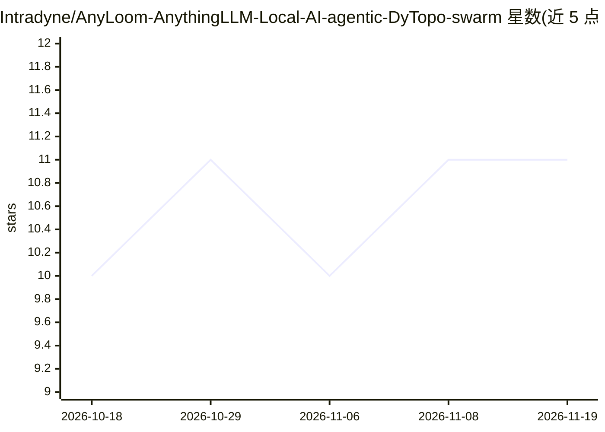

# Intradyne/AnyLoom-AnythingLLM-Local-AI-agentic-DyTopo-swarm

⭐ 11 · Python · MIT · 推送 2026-02-21 · [GitHub](https://github.com/Intradyne/AnyLoom-AnythingLLM-Local-AI-agentic-DyTopo-swarm) · 个人维护

**单 GPU 全本地运行的多 agent AI 助手栈：隐私问答与文档 RAG**

以 Docker Compose 编排的全本地 AI 助手栈：Qdrant 向量库、llama.cpp 推理与嵌入服务、AnythingLLM Web UI、DyTopo 多 agent 编排器与健康监控 sidecar。使用 Qwen3-30B-A3B Q4_K_M 模型（约 18.6 GiB）与 BGE-M3 嵌入，提供稠密+稀疏混合 RAG、8 个 MCP 服务器、检查点崩溃恢复、deny-first 工具策略与确定性输出校验。面向处理敏感代码与文档、要求零 API key、零订阅的工程师、研究者与隐私敏感用户。默认上下文 131K，可配置。

## 筛选速览

| 维度 | 判定 | 备注 |
|---|---|---|
| AI 角色 | `ai-native` | 本体是模型或模型工具 |
| 许可风险 | `permissive` | MIT |
| 部署形态 | `self-host` | docker 或自建部署 |
| 模型依赖 | local-ok | 支持本地模型 |
| 硬件要求 | `gpu-24g` | |
| 安装摩擦 | `low` | 无编译、无系统依赖或容器化 |
| 成熟度 | — | 结构信号不足 |

## 能力要点

- Docker Compose 一条命令启动整套服务栈，含健康监控与自动重启
- DyTopo 多 agent 编排：痕迹感知路由、检查点恢复、僵局检测、共识投票
- 稠密+稀疏混合 RAG，Qdrant 持久化，幂等文档嵌入脚本
- 8 个 MCP 服务器：记忆知识图谱、网页搜索、文件操作、系统诊断等

## 适用场景

- 在自有硬件上离线处理专有代码库与敏感文档问答
- 为需要跨会话持久记忆的自定义 AI 工作流搭建多 agent 协作
- 不依赖云端订阅服务运行私有 AI 助手

## 场景标签

`多智能体` `AI 助手` `文档问答` `RAG` · 领域:Agent 开发

## 证据(README 行号)

> L9: **Run a production-grade AI assistant stack entirely on your hardware:**
> L14: - 🤖 **Multi-agent swarm** — DyTopo coordination routes complex tasks to specialized agents that collaborate, with o
> L46: - **llama.cpp LLM** (port 8008) — GPU-accelerated inference with 131K context (Qwen3-30B-A3B)

## 星数曲线

2026-10-18 10 → 2026-11-19 11（+1）

---
*卡片 v1 · prompt 1.4 · 生成 2026-11-19 · 置信度 mid · 依据 README sha `cf2b67d6ada7` · [字段定义](../../DATASET.md)*
