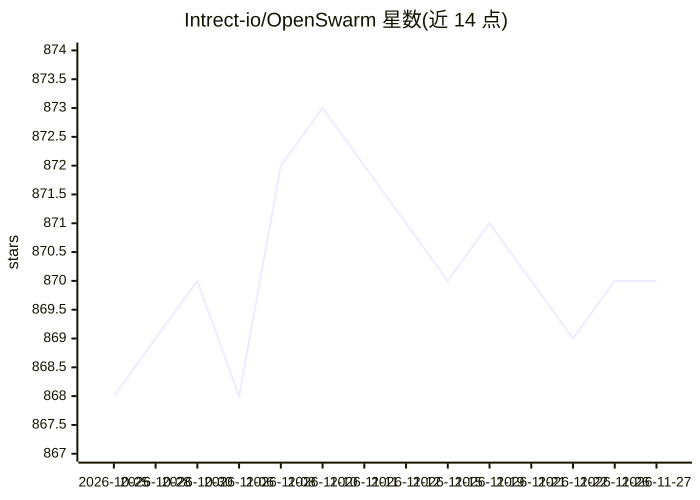

# Intrect-io/OpenSwarm

⭐ 870 · TypeScript · MIT · 推送 2026-11-21 · [GitHub](https://github.com/Intrect-io/OpenSwarm) · 组织维护

**用多模型 Agent 做 PR 评审门与自主开发编排的 CLI 工具**

OpenSwarm 是面向开发者的 agentic CI/CD 评审门：审查已提交或工作区 diff，可在隔离沙箱中分组修复确认的问题，复审后执行确定性仓库检查再发布 PR。支持 OpenAI Codex/GPT、OpenRouter 模型、本地开源模型（Ollama、LM Studio）与 Claude Code，带成本感知路由与 L0-L6 基准。可选编排层提供 Linear 自主守护进程、通知与按仓库积累的长期记忆；提供 TUI 聊天界面与 npm 全局安装。

## 筛选速览

| 维度 | 判定 | 备注 |
|---|---|---|
| AI 角色 | `ai-ecosystem` | LLM/agent 周边工具 |
| 许可风险 | `permissive` | MIT |
| 部署形态 | `self-host` | docker 或自建部署 |
| 模型依赖 | local-ok | 支持本地模型 |
| 硬件要求 | — | 无带数字的原话,不猜 |
| 安装摩擦 | `low` | 无编译、无系统依赖或容器化 |
| 成熟度 | — | 结构信号不足 |

## 能力要点

- review-fix-re-review-确定性验证的 PR 评审门，CI 按退出码判定（0/1/2 语义区分）
- 多 Provider 接入：codex-responses/openrouter/gpt/lmstudio/claude，成本感知路由
- read-only 默认拒绝变更工具，各适配器声明沙箱强制方式，未声明则拒跑
- Linux 用 bubblewrap 沙箱失败即中止，输出具体修复指引
- 任务结果按仓库存为长期知识并在未来 prompt 中召回

## 适用场景

- 在 PR 合并前自动评审并拦截未通过的变更
- 用 Linear 工单驱动异步 worker 管线并接入外部编排 agent
- 提交前本地对当前 diff 做只读评审
- 本地模型环境下无需账号运行评审流程

## 场景标签

`多智能体` `Agent 记忆` `代码审查` · 领域:Agent 开发

## 证据(README 行号)

> L10: > Agentic CI/CD gate — review, fix, re-review, and deterministic verification for pull requests and local changes
> L14: OpenSwarm is an **agentic CI/CD gate** for the change path that matters: it reviews a committed or working-tree dif
> L155: Autonomous pipelines enable baseline-diff verification by default: OpenSwarm runs repository test/typecheck comman

## 星数曲线

2026-10-25 868 → 2026-11-27 870（+2）

---
*卡片 v1 · prompt 1.4 · 生成 2026-11-24 · 置信度 mid · 依据 README sha `dcdb00794a61` · [字段定义](../../DATASET.md)*
