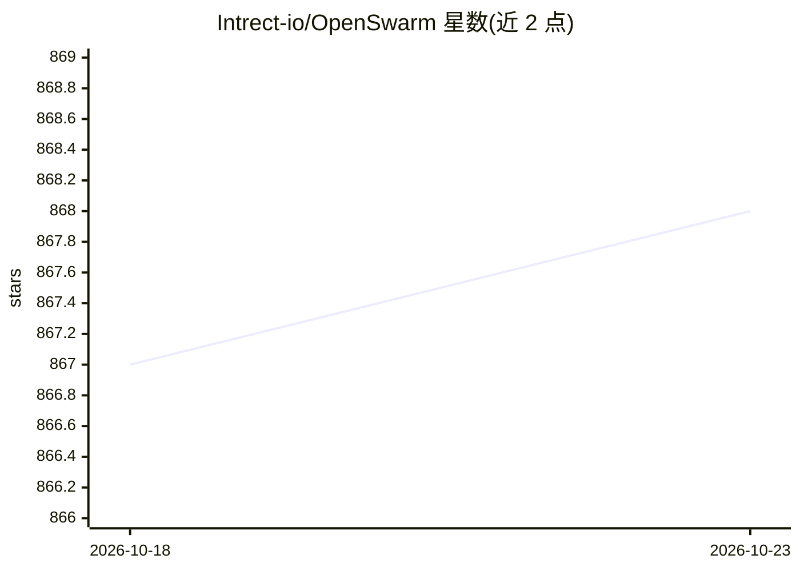

# Intrect-io/OpenSwarm

⭐ 868 · TypeScript · MIT · 推送 2026-10-22 · [GitHub](https://github.com/Intrect-io/OpenSwarm) · 组织维护

**面向 PR 的 agentic CI/CD 审查门：审查、修复、复审与确定性验证**

定位为提交变更路径上的 agentic CI/CD 门：审查已提交或工作区 diff，可在隔离沙箱中分组修复确认的问题，复审后在发布 PR 前强制确定性仓库检查。支持多种模型后端（OpenAI Codex/GPT、OpenRouter 任意模型、Ollama/LM Studio 本地模型、Claude Code CLI），带成本感知路由；本地命令行与 GitHub Action 两种使用方式。可选的编排层提供 Linear 任务后台、Discord/Slack/Telegram 通知、TUI 聊天与按仓库积累的长期记忆。Linux 下验证在 bubblewrap 沙箱中运行且失败即拒绝执行。

## 筛选速览

| 维度 | 判定 | 备注 |
|---|---|---|
| AI 角色 | `ai-ecosystem` | LLM/agent 周边工具 |
| 许可风险 | `permissive` | MIT |
| 部署形态 | `self-host` | docker 或自建部署 |
| 模型依赖 | local-ok | 支持本地模型 |
| 硬件要求 | — | 无带数字的原话,不猜 |
| 安装摩擦 | `low` | 无编译、无系统依赖或容器化 |
| 成熟度 | — | 结构信号不足 |

## 能力要点

- 审查→沙箱修复→复审→确定性验证的合并门流程，以退出码供 CI 判定
- 多 provider 接入：OpenRouter/OpenAI Codex/GPT/Ollama/LM Studio/Claude Code CLI，含成本感知路由
- Linux 验证默认运行于 bubblewrap 沙箱，无法沙箱化时拒绝执行（fail closed）
- 可选编排层：Linear 后台、多渠道通知、TUI、按仓库的任务知识记忆

## 适用场景

- 在提交或 PR 阶段用 AI 审查 diff 并自动修复确认的问题
- 把 AI 审查接入 CI 作为合并门，阻断未通过确定性验证的 PR
- 通过 Linear + Discord 运行自主开发守护进程处理仓库任务

## 场景标签

`编码 Agent` `代码审查` · 领域:编码与开发

## 证据(README 行号)

> L14: OpenSwarm is an **agentic CI/CD gate** for the change path that matters: it reviews a committed or working-tree dif
> L16: Use it locally before a commit or from the included GitHub Action on a pull request. The Linear-backed autonomous d
> L89: A composite action wraps the whole flow — install, diff against the PR base,

## 星数曲线

2026-10-18 867 → 2026-10-23 868（+1）

---
*卡片 v1 · prompt 1.4 · 生成 2026-10-21 · 置信度 mid · 依据 README sha `1c34aceb2f4d` · [字段定义](../../DATASET.md)*
