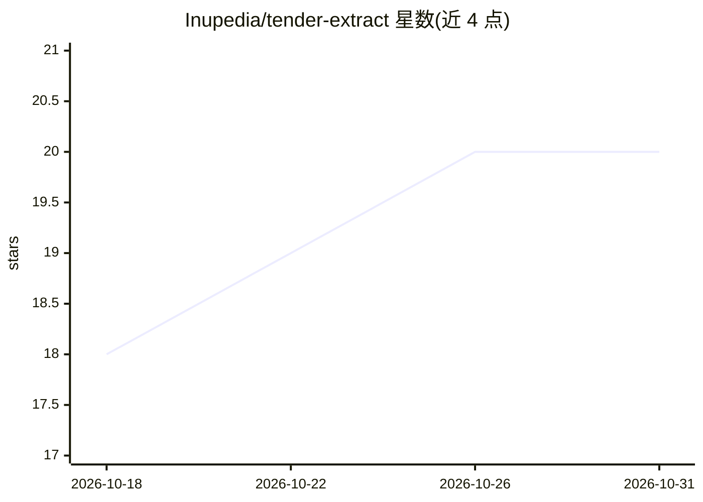

# Inupedia/tender-extract

⭐ 20 · Python · MIT · 推送 2026-09-17 · [GitHub](https://github.com/Inupedia/tender-extract) · 组织维护 · 中文 README

**中文招投标文档结构化抽取工具：规则/NER 优先，LLM 可选复核**

面向中文采购/招投标 PDF、DOCX、Markdown、TXT 的结构化字段抽取工具：默认用规则、词典与 NER 完成可确定字段，仅低置信、冲突或缺失字段进入可选 LLM 复核；每个字段保留来源文件、页码、原文片段与 PDF 坐标证据。支持项目级多文件（招标/补遗/多投标人）统一处理、人工复核回流为标注数据，以及 Precision/Recall/F1 质量评测与 CI 门禁。提供 Python CLI、FastAPI HTTP API 与 Docker/GHCR 镜像，要求 Python 3.12+。

## 筛选速览

| 维度 | 判定 | 备注 |
|---|---|---|
| AI 角色 | `ai-native` | 本体是模型或模型工具 |
| 许可风险 | `permissive` | MIT |
| 部署形态 | `self-host` | docker 或自建部署 |
| 模型依赖 | local-ok | 支持本地模型 |
| 硬件要求 | — | 无带数字的原话,不猜 |
| 安装摩擦 | `low` | 无编译、无系统依赖或容器化 |
| 成熟度 | — | 结构信号不足 |

## 能力要点

- 混合抽取：规则/词典/NER 优先，LLM 仅复核低置信或冲突字段
- 字段级证据定位：来源文件、页码、原文片段、PDF bbox
- 项目级多文件处理：补遗覆盖旧值但保留历史证据，投标人边界隔离
- 提供 CLI、HTTP API、Docker 三种入口，附 13 份真实 PDF 验收集（911 页）

## 适用场景

- 把招标 PDF 批量抽取成带溯源证据的结构化 JSON
- 一个项目下招标文件、补遗、多家投标文件统一处理
- 对抽取结果做人工复核并以 F1 门禁接入 CI

## 场景标签

`文档解析` · 领域:知识与检索

## 证据(README 行号)

> L3: **面向中文采购 / 招投标文档的结构化抽取工具。**
> L77: 默认先用规则与结构化方法完成可确定字段；只有低置信、冲突或缺失字段才进入可选的 LLM 复核流程。
> L83: |**混合抽取**|规则、词典、NER 与可选 LLM 复核组合使用|

## 星数曲线

2026-10-18 18 → 2026-10-31 20（+2）

---
*卡片 v1 · prompt 1.4 · 生成 2026-10-28 · 置信度 high · 依据 README sha `a6ea4b5357ac` · [字段定义](../../DATASET.md)*
