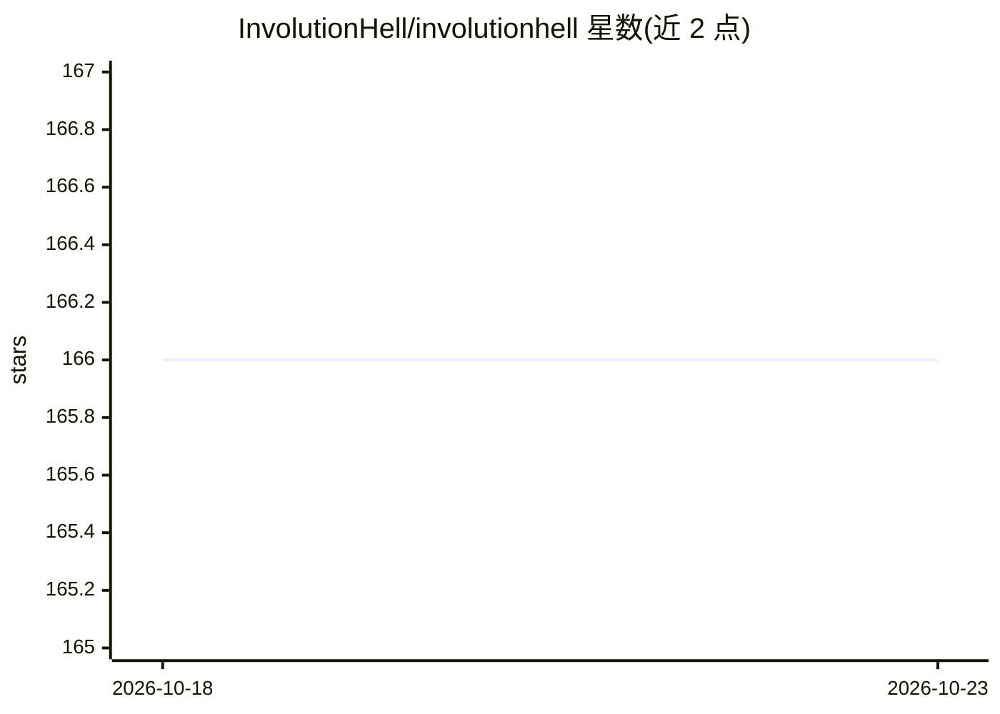

# InvolutionHell/involutionhell

⭐ 166 · MDX · Apache-2.0 · 推送 2026-10-21 · [GitHub](https://github.com/InvolutionHell/involutionhell) · [官网](https://involutionhell.com) · 组织维护 · 中文 README

**学生共享学习资料与课程笔记的开源网站**

非营利开源平台'内卷地狱'的网站仓库：帮助学生分享和获取学习资料、课程笔记和项目经验，主题标签涉及 UNSW/USYD/UTS 等澳洲高校。站点基于 Next.js App Router 与 Fumadocs UI 构建，采用'文件即导航'的分层文档结构，支持多语言，提供自动化部署、图片迁移与内容校验工具。代码以 Apache-2.0、内容以 CC BY-NC-SA 4.0 双协议授权，本地开发需 Node.js 18+ 与 pnpm@10.20.0。

## 筛选速览

| 维度 | 判定 | 备注 |
|---|---|---|
| AI 角色 | `ai-knowledge` | 知识聚合/清单类 |
| 许可风险 | `permissive` | Apache-2.0 |
| 部署形态 | `None` |  |
| 模型依赖 | — | README 未给出锁定关系 |
| 硬件要求 | — | 无带数字的原话,不猜 |
| 安装摩擦 | `low` | 无编译、无系统依赖或容器化 |
| 成熟度 | — | 结构信号不足 |

## 能力要点

- Next.js App Router + Fumadocs UI 站点，支持多语言与文件即导航
- 自动化图片迁移、Lint 规则与内容校验
- 代码（Apache-2.0）与内容（CC BY-NC-SA 4.0）分别授权

## 适用场景

- 查找和共享高校课程笔记与学习资料
- 贡献课程内容、翻译与文档改进
- 基于仓库自行部署学习资料站点

## 场景标签

`教程课程` · 领域:学习与行业

## 证据(README 行号)

> L29: 我们是**内卷地狱**，一个non-profit,open-source帮助学生分享和获取学习资料、课程笔记和项目经验的开源平台。
> L33: - Next.js App Router + Fumadocs UI 打造的高性能站点

## 星数曲线

2026-10-18 166 → 2026-10-23 166（+0）

---
*卡片 v1 · prompt 1.4 · 生成 2026-10-22 · 置信度 mid · 依据 README sha `94b0771532fd` · [字段定义](../../DATASET.md)*
