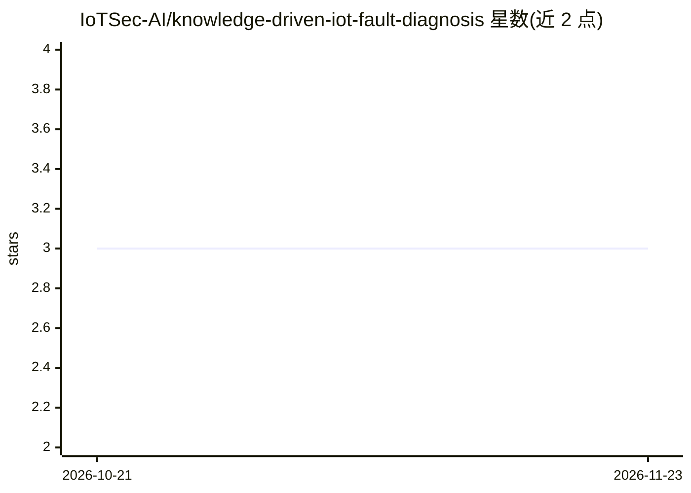

# IoTSec-AI/knowledge-driven-iot-fault-diagnosis

⭐ 3 · HTML · 推送 2026-10-18 · [GitHub](https://github.com/IoTSec-AI/knowledge-driven-iot-fault-diagnosis) · 个人维护

**面向 IoT 运维的知识驱动故障诊断助手**

结合实时传感器遥测、MQTT 通信、规则化故障监测、SQLite 遥测存储与 Web 监控仪表盘的 IoT 故障诊断系统。核心机制为：确定性规则判定当前状态，RAG 检索相关工程知识（主题标签显示使用 Chroma DB），由本地生成式 AI 模型解释异常状况并推荐检查项。面向 IoT 设备诊断场景，产出诊断解释与建议。

## 筛选速览

| 维度 | 判定 | 备注 |
|---|---|---|
| AI 角色 | `ai-native` | 本体是模型或模型工具 |
| 许可风险 | `none` | — |
| 部署形态 | `None` |  |
| 模型依赖 | — | README 未给出锁定关系 |
| 硬件要求 | — | 无带数字的原话,不猜 |
| 安装摩擦 | `low` | 无编译、无系统依赖或容器化 |
| 成熟度 | — | 结构信号不足 |

## 能力要点

- 规则判定 + RAG 知识检索 + 本地 LLM 解释的三层诊断流程
- MQTT 通信与实时传感器遥测接入
- SQLite 遥测存储与 Web 监控仪表盘
- 本地生成式 AI，诊断知识经 RAG 注入

## 适用场景

- 为 IoT 设备异常给出诊断解释和检查建议
- 对传感器遥测做实时规则化故障监测
- 搭建带本地 LLM 的 IoT 监控仪表盘

## 场景标签

`RAG` `数据分析` · 领域:效率与自动化

## 证据(README 行号)

> L5: A knowledge-driven IoT fault diagnosis system that combines real-time sensor telemetry, MQTT communication, rule-bas
> L25: > **Deterministic rules establish what is happening; RAG provides relevant engineering knowledge; the local LLM exp

## 星数曲线

2026-10-21 3 → 2026-11-23 3（+0）

---
*卡片 v1 · prompt 1.4 · 生成 2026-11-22 · 置信度 high · 依据 README sha `51cbb21d3eda` · [字段定义](../../DATASET.md)*
