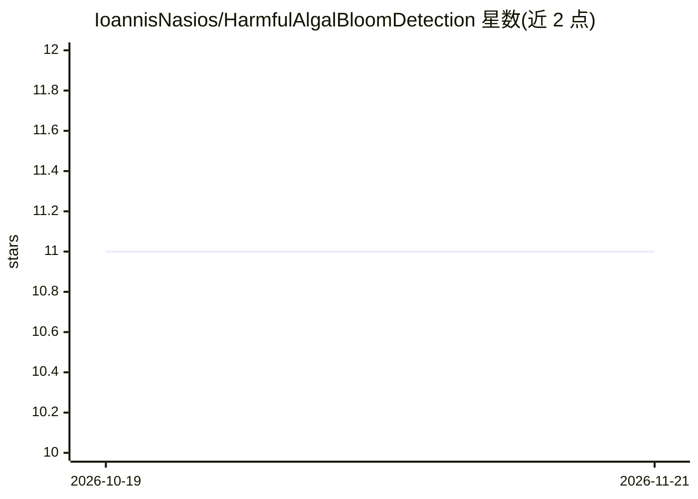

# IoannisNasios/HarmfulAlgalBloomDetection

⭐ 11 · Jupyter Notebook · 推送 2026-05-07 · [GitHub](https://github.com/IoannisNasios/HarmfulAlgalBloomDetection) · [官网](https://www.drivendata.org/competitions/143/tick-tick-bloom/) · 个人维护

**用多源数据融合的 ML 分类内陆水体蓝藻水华严重程度**

作者参加 NASA/Drivendata 主办的蓝藻水华严重程度分类竞赛（Tick Tick Bloom，序数回归任务）后的开源代码库。提供从 Google Earth Engine（Sentinel-2）、Planetary Computer（DEM）与 NOAA 气候数据下载原始数据的 notebook、构建数据集的 notebook，以及训练与推理 pipeline；简化版 pipeline 在私有 LB 得分 0.811。代码已被期刊论文采用，提供 BibTeX 引用条目。面向遥感与水环境研究者及竞赛参与者。

## 筛选速览

| 维度 | 判定 | 备注 |
|---|---|---|
| AI 角色 | `ai-native` | 本体是模型或模型工具 |
| 许可风险 | `none` | — |
| 部署形态 | `None` |  |
| 模型依赖 | — | README 未给出锁定关系 |
| 硬件要求 | — | 无带数字的原话,不猜 |
| 安装摩擦 | `low` | 无编译、无系统依赖或容器化 |
| 成熟度 | — | 结构信号不足 |

## 能力要点

- 融合 Sentinel-2 卫星影像、DEM 地形与 NOAA 气候三类数据源
- 提供数据下载、数据集构建、训练与推理的完整 notebook 流程
- 简化版 pipeline 在竞赛私有 LB 得分 0.811
- 代码支撑已发表论文并附 BibTeX

## 适用场景

- 对小内陆水体做蓝藻水华严重程度的序数回归分类
- 复现竞赛方案或在其上做改进实验
- 参考多源遥感/气候数据的融合建模流程

## 场景标签

`科研工具` · 领域:学习与行业

## 证据(README 行号)

> L7: * **Problem statement:** use satellite imagery to detect and classify the severity of cyanobacteria blooms in small,
> L26: Training and inference pipeline below is a simplified version ranked 6th scoring 0.811 on private LB instead of aut
> L31: **This code has been used in the research paper "AI-driven multi-source data fusion for algal bloom severity classi

## 星数曲线

2026-10-19 11 → 2026-11-21 11（+0）

---
*卡片 v1 · prompt 1.4 · 生成 2026-11-19 · 置信度 high · 依据 README sha `21612c3efdfb` · [字段定义](../../DATASET.md)*
