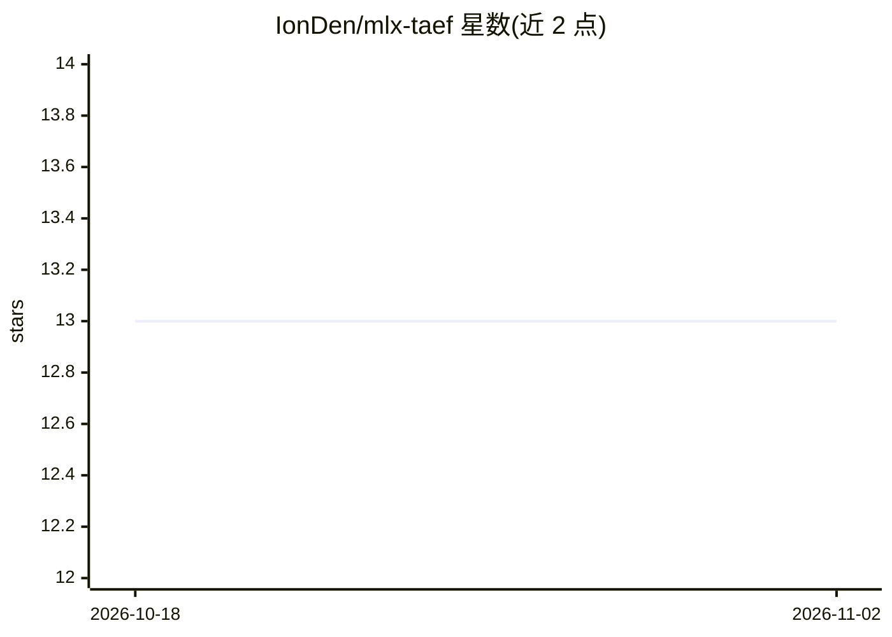

# IonDen/mlx-taef

⭐ 13 · Python · MIT · 推送 2026-10-29 · [GitHub](https://github.com/IonDen/mlx-taef) · 个人维护

**Apple Silicon 上的微型扩散 VAE 解码器库：毫秒级潜空间预览与低内存解码**

TAESD 家族的纯 MLX 移植，覆盖 TAESD/TAESDXL/TAEF1/TAEF2/Z-Image/Qwen-Image 等变体，用几 MB 的蒸馏微型自编码器替代数 GB 完整 VAE，将扩散潜变量毫秒级解码为 RGB，支持编码与解码两个方向。面向 Mac 上的 FLUX/SD 生成用户：提供 mflux LivePreviewCallback 每步实时预览、16 GB 机型上完整 VAE OOM 时的低内存回退路径（TAEF2 峰值约 0.59 GB），及 notebook 中的潜空间检查。限制：需 Python ≥3.11 与 Apple Silicon（mlx 仅支持该平台）；mflux extra 会引入 PyTorch。基准数据与复现脚本见 COMPARISON.md。

## 筛选速览

| 维度 | 判定 | 备注 |
|---|---|---|
| AI 角色 | `ai-native` | 本体是模型或模型工具 |
| 许可风险 | `permissive` | MIT |
| 部署形态 | `library` | 以包/库形式分发 |
| 模型依赖 | — | README 未给出锁定关系 |
| 硬件要求 | — | 无带数字的原话,不猜 |
| 安装摩擦 | `low` | 无编译、无系统依赖或容器化 |
| 成熟度 | — | 结构信号不足 |

## 能力要点

- TAEF1/TAEF2 解码在 M1 Max 上约 30 ms，完整 VAE 约 0.3 s
- mflux LivePreviewCallback 每步实时预览集成
- 7 个变体共享一套 API，覆盖 SD1.x/SDXL/FLUX.1/FLUX.2 Klein/Z-Image/Qwen-Image/Krea 2
- 权重加载严格校验，错误形状/通道输入抛出明确异常

## 适用场景

- Mac 上跑 FLUX 生成时逐步查看实时预览
- 16 GB 内存机型完整 VAE 解码 OOM 时的低内存替代
- notebook 与 ML 研究中快速检查潜空间解码结果

## 场景标签

`图像视频处理` · 领域:感知与多模态

## 证据(README 行号)

> L11: `mlx-taef` is the first MLX port of the TAESD family — TAESD (SD1.x), TAESDXL (SDXL), TAEF1 (FLUX.1), TAEF2 (FLUX.2
> L14: - **Live previews** during long generations on Mac — the decode step itself takes ~30 ms for both TAEF1 and TAEF2 o
> L24: img_uint8 = taef.decode_image(latents)      # uint8 NHWC ready for PIL

## 星数曲线

2026-10-18 13 → 2026-11-02 13（+0）

---
*卡片 v1 · prompt 1.4 · 生成 2026-10-31 · 置信度 high · 依据 README sha `8576e6174cd9` · [字段定义](../../DATASET.md)*
