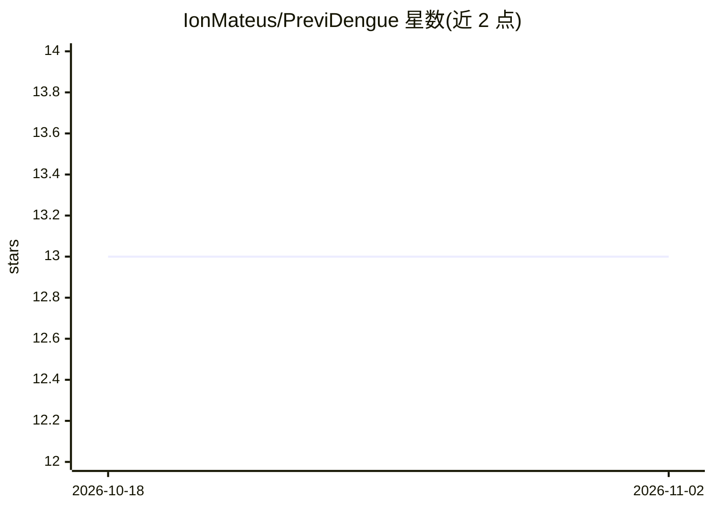

# IonMateus/PreviDengue

⭐ 13 · Jupyter Notebook · MIT · 推送 2026-04-14 · [GitHub](https://github.com/IonMateus/PreviDengue) · [官网](https://previdengue.vercel.app/) · 组织维护

**登革热监测平台：AI 检测蚊虫孳生地并预测疫情暴发**

面向公共卫生工作者与社区的 TCC 项目平台，含两个 AI 模块：一是用 YOLO 对高分辨率航拍图像检测水池、水箱等潜在孳生地，按区域生成风险评分并以交互式热力图展示；二是用 LSTM 神经网络基于 DATASUS 历史病例序列与 NASA 气候数据预测登革热病例趋势。后端 FastAPI，前端 Next.js，模型在 Google Colab 训练并通过 Hugging Face 以 REST API 暴露。README 自述代码源'即将'开放，演示部署在 Vercel。

## 筛选速览

| 维度 | 判定 | 备注 |
|---|---|---|
| AI 角色 | `ai-native` | 本体是模型或模型工具 |
| 许可风险 | `permissive` | MIT |
| 部署形态 | `library` | 以包/库形式分发 |
| 模型依赖 | — | README 未给出锁定关系 |
| 硬件要求 | — | 无带数字的原话,不猜 |
| 安装摩擦 | `low` | 无编译、无系统依赖或容器化 |
| 成熟度 | `idea` | |

## 能力要点

- YOLO 检测航拍图像中的孳生地并生成风险评分热力图
- LSTM 基于 DATASUS 病例数据与 NASA 气候数据预测疫情趋势
- FastAPI 后端 + Next.js 前端，模型经 Hugging Face 以 REST API 提供
- 提供在线演示版本（Vercel 部署）

## 适用场景

- 公共卫生人员查看区域孳生地风险热力图以规划灭蚊行动
- 依据疫情趋势预测提前分配防治资源
- 上传航拍图像获得孳生地检测结果

## 场景标签

`目标检测` · 领域:感知与多模态

## 证据(README 行号)

> L27: Utilizamos Visão Computacional para analisar imagens aéreas de alta resolução e identificar potenciais criadouros d
> L33: Este módulo utiliza modelos de aprendizado de máquina para prever a tendência de casos de dengue, auxiliando na alo
> L35: > **🧠 Como Funciona:** Um modelo de **Rede Neural LSTM (Long Short-Term Memory)** é treinado com uma série históric

## 星数曲线

2026-10-18 13 → 2026-11-02 13（+0）

---
*卡片 v1 · prompt 1.4 · 生成 2026-10-31 · 置信度 high · 依据 README sha `3da88600e18d` · [字段定义](../../DATASET.md)*
