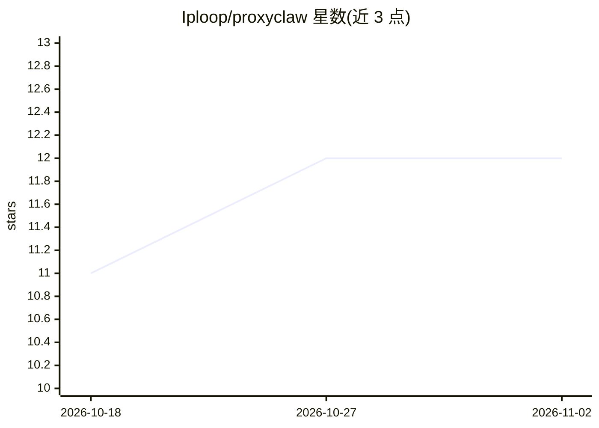

# Iploop/proxyclaw

⭐ 12 · Python · MIT · 推送 2026-04-30 · [GitHub](https://github.com/Iploop/proxyclaw) · [官网](https://proxyclaw.ai) · 组织维护

**面向 AI 代理与爬虫的住宅代理 SDK（200 万 IP、195 国）**

IPLoop 公司的住宅代理平台客户端：提供 Python/Node.js SDK、curl 端点与 LangChain 集成包，通过 API key 接入 proxy.iploop.io 网关，支持按国家/城市定向、会话保持，协议含 HTTP/HTTPS/SOCKS5；带隐身模式声称绕过 Cloudflare、Akamai 等反爬系统，内置 67 个站点预设。面向 AI agent 开发者与数据采集场景。免费层 0.5GB，可通过运行 Docker 节点分享带宽换取额度，商业服务按 GB 计费。

## 筛选速览

| 维度 | 判定 | 备注 |
|---|---|---|
| AI 角色 | `ai-ecosystem` | LLM/agent 周边工具 |
| 许可风险 | `permissive` | MIT |
| 部署形态 | `self-host` | docker 或自建部署 |
| 模型依赖 | — | README 未给出锁定关系 |
| 硬件要求 | — | 无带数字的原话,不猜 |
| 安装摩擦 | `low` | 无编译、无系统依赖或容器化 |
| 成熟度 | — | 结构信号不足 |

## 能力要点

- Python（pip）与 Node.js（npm）双 SDK，另支持 curl 直连代理端点
- 官方 LangChain 集成包（ProxyClawTool / ProxyClawScraperTool）
- 67 个站点预设与隐身模式（浏览器指纹 + 住宅 IP）
- 按国家/城市/会话定向，支持 HTTP/HTTPS/SOCKS5

## 适用场景

- 让 AI agent 以住宅 IP 访问目标网站并抓取数据
- 数据管道中绕过地域限制做定向采集
- 通过分享带宽运行 Docker 节点换取代理额度

## 场景标签

`网页抓取` · 领域:效率与自动化

## 证据(README 行号)

> L3: Residential proxy platform for AI agents, bots & data pipelines — 2M+ residential IPs, 195+ countries, anti-bot bypa
> L62: ### LangChain (AI Agents)

## 星数曲线

2026-10-18 11 → 2026-11-02 12（+1）

---
*卡片 v1 · prompt 1.4 · 生成 2026-11-01 · 置信度 mid · 依据 README sha `defc5568b9d4` · [字段定义](../../DATASET.md)*
