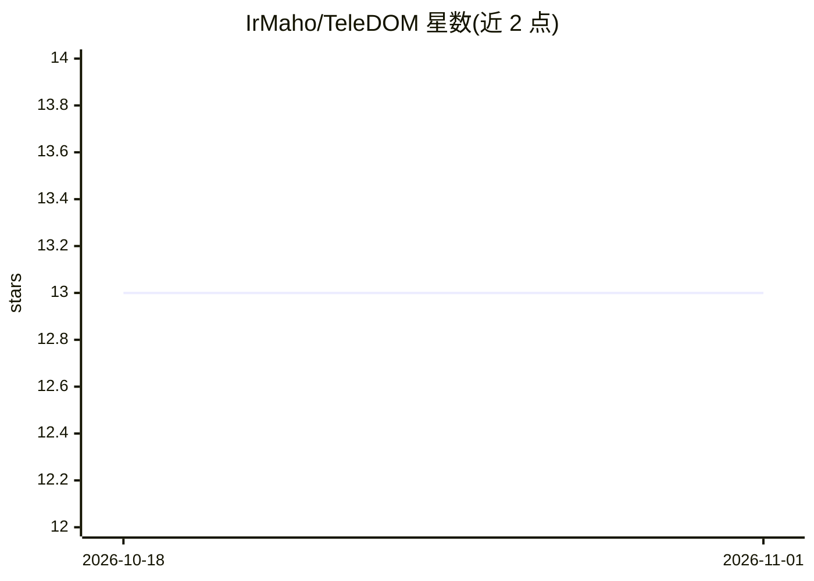

# IrMaho/TeleDOM

⭐ 13 · TypeScript · Apache-2.0 · 推送 2026-09-11 · [GitHub](https://github.com/IrMaho/TeleDOM) · [官网](https://github.com/IrMaho/TeleDOM#readme) · 个人维护 · 中文 README

**面向 AI agent 的浏览器智能与工作流运行时：350 个 MCP 工具**

以 Chrome 扩展（Manifest V3）+ Node.js MCP 服务器双运行时形态提供 350 个 JSON-RPC 2.0 工具，覆盖 DOM 时序回溯（时间旅行/状态重建）、目标记忆、工作流保存与确定性重放、反事实仿真、事故根因调查、DevTools 检查与安全扫描。面向 Claude、Cursor、Cline、Antigravity 等 AI 编码 agent 与前端团队使用，另有零依赖 Python SDK 与全局 CLI（dom-antigravity）。安装途径为 npm 全局/工作区安装并手动加载未打包扩展。

## 筛选速览

| 维度 | 判定 | 备注 |
|---|---|---|
| AI 角色 | `ai-ecosystem` | LLM/agent 周边工具 |
| 许可风险 | `permissive` | Apache-2.0 |
| 部署形态 | `library` | 以包/库形式分发 |
| 模型依赖 | — | README 未给出锁定关系 |
| 硬件要求 | — | 无带数字的原话,不猜 |
| 安装摩擦 | `low` | 无编译、无系统依赖或容器化 |
| 成熟度 | — | 结构信号不足 |

## 能力要点

- 350 个 MCP 工具分四个家族（td_/dt_/fx_/Core），350/350 stdio 认证
- Temporal EventMesh 内核：哈希链事件日志、亚毫秒级 DOM 时间旅行与确定性重放
- Agent-Owned 工作流：保存/参数化/版本/diff/重放，目标记忆避免重复 DOM 分析
- 零依赖 Python SDK 与专用 CLI dom-antigravity

## 适用场景

- 让 Claude/Cursor 等 AI 编码 agent 直接操作与分析浏览器页面
- 把一次性浏览器任务固化为可重放的工作流程序
- 前端事故根因调查与反事实仿真验证

## 场景标签

`浏览器自动化` `工作流自动化` · 领域:效率与自动化

## 证据(README 行号)

> L63: TeleDOM is a production-grade **Temporal Browser Intelligence Engine** and universal **Model Context Protocol (MCP)
> L143: 2. **Node.js / MCP Server Runtime (`ForensicMCPServer`)**:
> L144:  - Exposes **350 JSON-RPC 2.0 MCP tools** over `stdio` and HTTP.

## 星数曲线

2026-10-18 13 → 2026-11-01 13（+0）

---
*卡片 v1 · prompt 1.4 · 生成 2026-10-31 · 置信度 high · 依据 README sha `656de8b52c77` · [字段定义](../../DATASET.md)*
