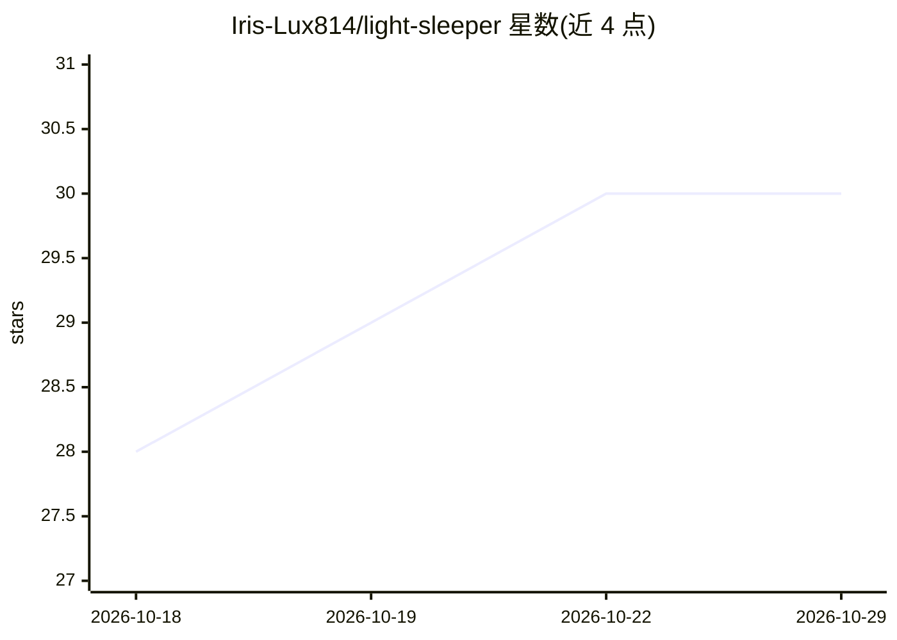

# Iris-Lux814/light-sleeper

⭐ 30 · JavaScript · AGPL-3.0 · 推送 2026-10-19 · [GitHub](https://github.com/Iris-Lux814/light-sleeper) · 个人维护 · 中文 README

**给 AI 伴侣加睡眠/做梦机制的库**

一个 JavaScript 睡眠引擎库，置于长时运行 AI 伴侣（终端 agent、聊天应用、语音助手）的消息收件箱之前：实现带困意的睡眠/唤醒状态机、按睡眠深度决定消息是否唤醒、睡眠期拦截自动化注入、按睡眠周期生成梦境（碎片回忆式或实时对话式）、长期记忆化的深度梦境与晨起余韵。基于睡眠研究文献设计。引擎自身不调用模型，梦境由外部传入的模型（需返回 JSON）生成；适配 Telegram、Discord、SillyTavern、Open WebUI 等宿主，支持无 Node 环境（QuickJS）打包为单文件。API 在 1.0 前可能变动。

## 筛选速览

| 维度 | 判定 | 备注 |
|---|---|---|
| AI 角色 | `ai-ecosystem` | LLM/agent 周边工具 |
| 许可风险 | `viral` | AGPL-3.0 |
| 部署形态 | `None` |  |
| 模型依赖 | — | README 未给出锁定关系 |
| 硬件要求 | — | 无带数字的原话,不猜 |
| 安装摩擦 | `low` | 无编译、无系统依赖或容器化 |
| 成熟度 | `idea` | |

## 能力要点

- 睡眠/唤醒状态机与按睡眠深度判定消息唤醒概率
- 梦境分碎片回忆式与实时对话式（独立模型逐场景生成）
- 引擎自身不调用模型，任何模型可用（梦境需返回 JSON）
- 可打包为单文件在 QuickJS 等无 Node 环境运行

## 适用场景

- 为我的终端或聊天 AI 伴侣添加睡眠与做梦行为
- 让 Telegram/Discord 上的伴侣在夜间入睡且可被叫醒
- 研究性伴侣 agent 中实现基于睡眠科学的周期机制

## 场景标签

`Agent 记忆` · 领域:Agent 开发

## 证据(README 行号)

> L10: It's built for long-running AI companions (an agent that lives in a terminal, a chat app, a voice assistant) that a
> L71: |`src/sleep-engine.js`|The state machine: falling asleep and waking, the message gate, dream scheduling, the wake-u
> L75: |`src/dream-prompt.js`|A separate model writes the dream. Builds the prompt, calls the model you pass in, checks th

## 星数曲线

2026-10-18 28 → 2026-10-29 30（+2）

---
*卡片 v1 · prompt 1.4 · 生成 2026-10-26 · 置信度 high · 依据 README sha `1ee742673d35` · [字段定义](../../DATASET.md)*
