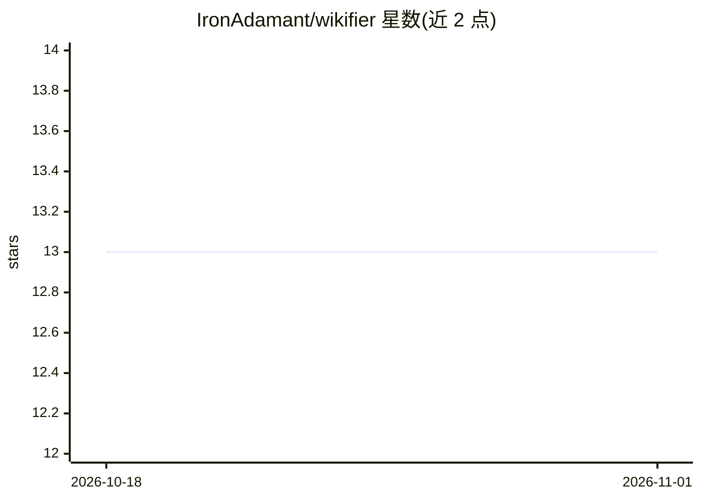

# IronAdamant/wikifier

⭐ 13 · Rust · MIT · 推送 2026-10-31 · [GitHub](https://github.com/IronAdamant/wikifier) · [官网](https://github.com/IronAdamant/wikifier) · 个人维护

**面向 AI agent 的零依赖代码库 wiki 与变更追踪系统**

用纯标准库 Rust 实现的命令行工具，为 AI agent 生成并维护代码库的结构化地图：多语言（Python/JS/TS/Rust/Go/C/C++/C#/Java）import 依赖图、健康矩阵、每文件 wiki 笔记、变更日志与工作队列。通过 CLI、Python 库接口与 MCP 服务器（供 Claude/Cursor/Cline 等 MCP 客户端使用）提供 session-bootstrap、check-changes、record-change、mark-green 等 agent 循环命令，目标是让 LLM 查地图而非重读源码。从源码 cargo build 构建，原 PyPI 包已归档不再维护。

## 筛选速览

| 维度 | 判定 | 备注 |
|---|---|---|
| AI 角色 | `ai-ecosystem` | LLM/agent 周边工具 |
| 许可风险 | `permissive` | MIT |
| 部署形态 | `library` | 以包/库形式分发 |
| 模型依赖 | — | README 未给出锁定关系 |
| 硬件要求 | — | 无带数字的原话,不猜 |
| 安装摩擦 | `medium` | 含编译或系统依赖之一 |
| 成熟度 | — | 结构信号不足 |

## 能力要点

- 8 种语言的 import/include 依赖图与循环检测
- 健康矩阵（绿/黄/红）与 mark-green 公共符号校验
- MCP 服务器供 Claude、Cursor 等 MCP 客户端接入
- 零核心依赖的 std-only Rust 二进制，支持大规模 monorepo 分片地图

## 适用场景

- 让 coding agent 在编辑前用少量 token 查明文件依赖关系
- 维护项目健康矩阵，按红/黄优先级安排修改
- 通过 MCP 客户端在会话中自动记录变更原因并保持 wiki 最新

## 场景标签

 · 领域:开发工具/代码库知识管理

## 证据(README 行号)

> L17: **A zero-dependency codebase wiki for AI agents.** Token-efficient maps so LLMs look things up instead of re-readin
> L19: Wikifier is an **agent-to-agent** tool: it builds a living map of a project (health matrix, dependency graph, short
> L97: - **MCP tools** — optional server for Claude, Cursor, Cline, and other MCP clients

## 星数曲线

2026-10-18 13 → 2026-11-01 13（+0）

---
*卡片 v1 · prompt 1.4 · 生成 2026-11-01 · 置信度 mid · 依据 README sha `5f3a78212615` · [字段定义](../../DATASET.md)*
