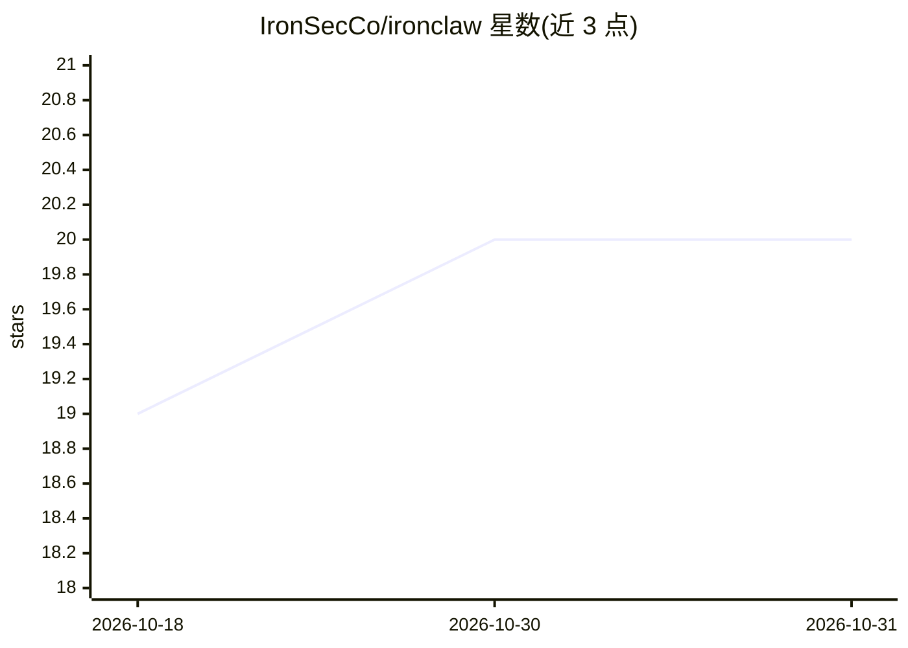

# IronSecCo/ironclaw

⭐ 20 · Go · AGPL-3.0 · 推送 2026-10-28 · [GitHub](https://github.com/IronSecCo/ironclaw) · [官网](https://ironsecco.github.io/ironclaw/) · 组织维护

**自托管安全沙箱 AI agent 运行时：可验证的隔离边界**

Go 编写的自托管 AI agent 平台：agent 以编译后二进制运行在 gVisor 沙箱内（network=none、非 root、只读 rootfs），模型调用经宿主代理转发，任何配置变更须经人工审批网关并写入只追加审计日志。通过聊天应用接入，提供 CLI（ironctl）与 HTTP API。附带 ironctl scan 工具，可对任意容器、Dockerfile 打 0-100 隔离评分并作为 GitHub Action 在 PR 上运行。自述处于 alpha：接口可能变动，Windows 原生不支持沙箱（需 WSL2），macOS 隔离弱于 Linux+gVisor。

## 筛选速览

| 维度 | 判定 | 备注 |
|---|---|---|
| AI 角色 | `ai-ecosystem` | LLM/agent 周边工具 |
| 许可风险 | `dual` | AGPL-3.0 |
| 部署形态 | `desktop` | 安装包/桌面程序 |
| 模型依赖 | — | README 未给出锁定关系 |
| 硬件要求 | — | 无带数字的原话,不猜 |
| 安装摩擦 | `low` | 无编译、无系统依赖或容器化 |
| 成熟度 | `idea` | |

## 能力要点

- gVisor + network=none 的密封沙箱，模型调用经宿主代理
- 能力变更经人工审批网关并写入只追加审计日志
- ironctl scan 对任意容器/Dockerfile 输出 0-100 隔离评分（含 GitHub Action 与 pre-commit 钩子）
- 零凭证 30 秒演示：越狱 agent 三次逃逸尝试均被拦截

## 适用场景

- 在自有基础设施上运行不信任的自主 AI agent 并验证隔离
- 对已有容器和 Dockerfile 做隔离评分与加固
- 在 CI 中对每个 PR 自动输出沙箱隔离报告

## 场景标签

`Agent 框架` `网络安全` · 领域:Agent 开发

## 证据(README 行号)

> L26: **IronClaw runs autonomous AI agents on infrastructure you control**, reached through the chat apps
> L28: inside a sealed sandbox with `network=none`: it reaches the model only through a host proxy, and it
> L130: This is a feature, not a missing dashboard. Every capability is a documented HTTP endpoint **and** an

## 星数曲线

2026-10-18 19 → 2026-10-31 20（+1）

---
*卡片 v1 · prompt 1.4 · 生成 2026-10-29 · 置信度 high · 依据 README sha `73f2a7a5e870` · [字段定义](../../DATASET.md)*
