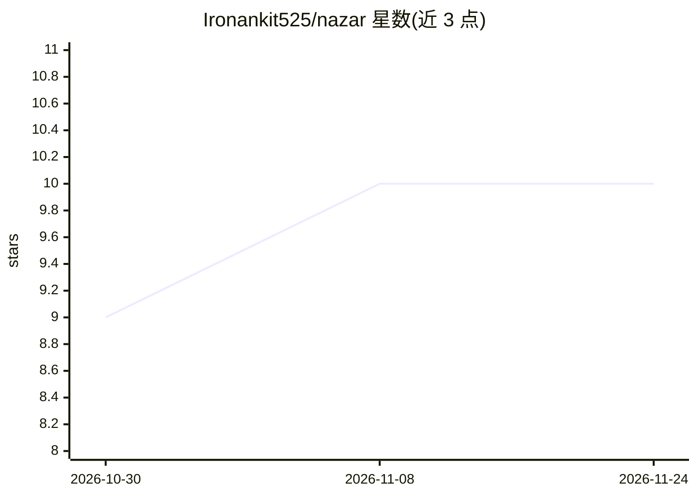

# Ironankit525/nazar

⭐ 10 · TypeScript · MIT · 推送 2026-10-29 · [GitHub](https://github.com/Ironankit525/nazar) · [官网](https://github.com/marketplace/actions/nazar-ai-code-review) · 个人维护

**面向印度学生的免费 AI 代码审查：GitHub Action + CLI**

以 GitHub Action 与 CLI 形式运行的代码审查工具，审查 pull request 与 push：查找逻辑错误与安全漏洞（SQL/XSS/路径穿越等），用无 AI 的正则+熵扫描检测泄露的密钥，注释中嵌入 GitHub suggestion 实现一键修复。采用两遍审查（第二遍 verifier 过滤误报），输出经 zod 校验的严格 JSON，仅引用 diff 内行号以剔除幻觉。依赖 BharatCode 平价 API，对学生免费，diff 只发送到 BharatCode，无服务器、无遥测，AI 不可用时密钥与仓库检查仍运行。

## 筛选速览

| 维度 | 判定 | 备注 |
|---|---|---|
| AI 角色 | `ai-native` | 本体是模型或模型工具 |
| 许可风险 | `permissive` | MIT |
| 部署形态 | `library` | 以包/库形式分发 |
| 模型依赖 | — | README 未给出锁定关系 |
| 硬件要求 | — | 无带数字的原话,不猜 |
| 安装摩擦 | `low` | 无编译、无系统依赖或容器化 |
| 成熟度 | — | 结构信号不足 |

## 能力要点

- 两遍审查机制：verifier 显式批准每条发现，丢弃误报
- 非 AI 的正则+熵密钥扫描，覆盖 GitHub/OpenAI/AWS/Stripe 等密钥类型，nazar:allow 可豁免
- 注释含 GitHub suggestion 块，一键提交修复
- 自附 eval 套件，输出 precision/recall/干净代码噪音指标

## 适用场景

- 学生和独立开发者在 GitHub PR 上获得免费代码审查
- CI 中拦截硬编码的 API 密钥与数据库密码
- 推送 main 前用 CLI 审查未提交改动并作为 git hook 失败门槛
- 用 Hinglish 语言获得审查说明

## 场景标签

`代码审查` · 领域:编码与开发

## 证据(README 行号)

> L16: *Nazar* (नज़र) means "a watchful eye". It reads every pull request and push, catches real bugs and security holes, 
> L18: AI code reviewers usually cost $15–30 a month per developer, which leaves out most students and indie developers in
> L28: |🧠 **Two-pass review**|A second "verifier" pass checks every finding and drops false positives before you see them.

## 星数曲线

2026-10-30 9 → 2026-11-24 10（+1）

---
*卡片 v1 · prompt 1.4 · 生成 2026-11-20 · 置信度 high · 依据 README sha `49d3dccb83b6` · [字段定义](../../DATASET.md)*
